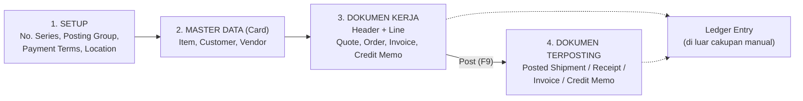
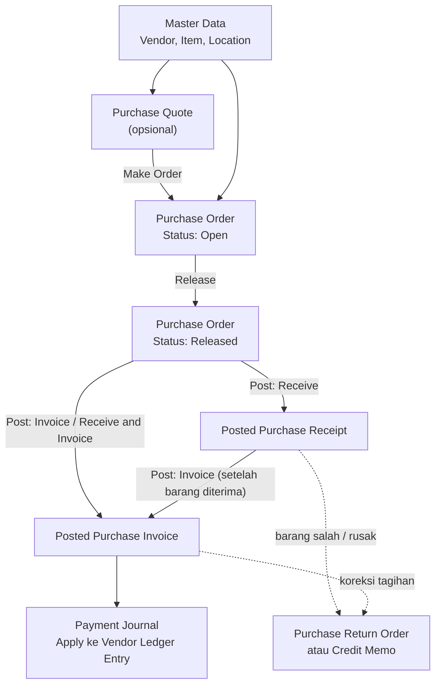
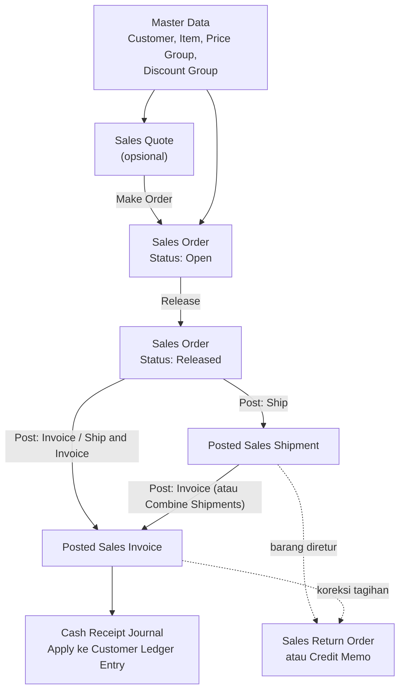

# Overview

### Purchasing Flow dan Selling Flow — Panduan untuk Pengguna dengan Latar Belakang ERPNext

> **Versi acuan:** Microsoft Dynamics NAV 2017 (W1), Windows Client (RoleTailored Client).
> Nama menu, field, dan tabel ditulis dalam bahasa Inggris persis seperti tampilan aplikasi, sedangkan penjelasannya dalam Bahasa Indonesia.
> Jika instalasi Anda memakai lokalisasi atau add-on dari partner, mungkin ada field tambahan atau perilaku yang sedikit berbeda. Selalu uji di database *test* terlebih dahulu.

---

## 1. Daftar File Manual

| No | File | Isi |
|----|------|-----|
| 00 | `00-pengantar-dan-pemetaan-erpnext.md` (file ini) | Cara berpikir NAV, perbedaan dengan ERPNext, pemetaan istilah, peta flow |
| 01 | `01-master-data.md` | Setup dasar, Item, Customer, Vendor, master pendukung, relasi tabel master |
| 02 | `02-purchase-flow.md` | Alur pembelian end to end: Quote → Order → Receipt → Invoice → Payment, Return |
| 03 | `03-selling-flow.md` | Alur penjualan end to end: Quote → Order → Shipment → Invoice → Payment, Return |
| 04 | `04-customer-price-group-dan-discount-group.md` | Mekanisme harga & diskon: Customer Price Group, Customer Discount Group, Item Discount Group |

**Urutan belajar yang disarankan:** 00 → 01 → 02 → 03 → 04.

---

## 2. Ruang Lingkup

**Termasuk:**
- Master data yang dibutuhkan transaksi pembelian & penjualan
- Dokumen transaksi (Header dan Line), status, field penting, dan relasi tabel
- Dokumen terposting (Posted Receipt, Posted Shipment, Posted Invoice, Credit Memo)
- Customer Price Group, Customer Discount Group, Item Discount Group
- Pelunasan (settlement) secara ringkas pada level Customer/Vendor Ledger Entry

**Tidak termasuk (sesuai permintaan):**
- Entri akuntansi: `G/L Entry`, `General Posting Setup` (pemetaan akun), `VAT Entry`
- Pergerakan stok dan costing: `Item Ledger Entry`, `Value Entry`, `Adjust Cost`
- Manufacturing, Warehouse Management lanjutan, Service, Jobs, Dimensions secara mendalam

> **Catatan penting:** Saat dokumen di-*Post*, NAV tetap membuat entri akuntansi dan pergerakan stok di belakang layar. Manual ini hanya menyebut keberadaannya agar Anda paham mengapa ada error posting tertentu, tanpa membahas isinya.

---

## 3. Konvensi Penulisan

| Penulisan | Arti |
|-----------|------|
| `Sell-to Customer No.` | Nama field persis seperti di NAV |
| **Sales Header (36)** | Nama tabel diikuti nomor objek tabel pada NAV 2017 standar |
| `Tabel.Field → Tabel.Field` | Relasi tabel (*TableRelation*) |
| Diagram `mermaid` | Flowchart/ER diagram; tampil otomatis di GitHub, GitLab, VS Code (dengan ekstensi Markdown Mermaid), Obsidian, dan Typora |

---

## 4. Cara Berpikir NAV (Dibanding ERPNext)

### 4.1 Empat Lapis Data

| Lapis | Contoh di NAV | Padanan di ERPNext |
|-------|---------------|--------------------|
| Setup | `Sales & Receivables Setup`, `No. Series` | Selling Settings, Buying Settings, Naming Series |
| Master | `Item`, `Customer`, `Vendor` | Item, Customer, Supplier |
| Dokumen kerja | `Sales Header` + `Sales Line` | Sales Order (draft) |
| Dokumen terposting | `Sales Invoice Header` + `Sales Invoice Line` | Sales Invoice (submitted) |

### 4.2 Perbedaan Terbesar: Dokumen Kerja vs Dokumen Terposting

Ini konsep yang paling sering membingungkan orang ERPNext.

- **ERPNext:** satu DocType, satu record. Perubahan status memakai `docstatus` (0 Draft, 1 Submitted, 2 Cancelled). Dokumen turunan dibuat lewat tombol *Create*.
- **NAV:** dokumen yang Anda ketik (Sales Order) berada di tabel **Sales Header/Line**. Saat di-*Post*, NAV **membuat dokumen baru di tabel lain** (Sales Shipment Header, Sales Invoice Header), yang bersifat **permanen dan tidak bisa diedit**.

| Aspek | ERPNext | NAV 2017 |
|-------|---------|----------|
| Menyimpan dokumen final | Submit (docstatus = 1) | **Post** (F9) → lahir dokumen *Posted* di tabel terpisah |
| Mengubah dokumen final | Cancel → Amend | Tidak bisa. Koreksi lewat **Credit Memo / Return Order**, *Undo Shipment/Receipt*, atau *Correct/Cancel Invoice* |
| Dokumen turunan | Create → Delivery Note / Invoice (mapping) | Cukup **Post** dari Order yang sama, pilih *Ship*, *Invoice*, atau *Ship and Invoice* |
| Pengiriman/penerimaan parsial | Buat Delivery Note baru per sebagian | Isi `Qty. to Ship` / `Qty. to Receive` pada baris Order, lalu Post berulang |
| Setelah semuanya selesai | Order tetap ada, status *Completed* | Order **dihapus otomatis** setelah fully shipped & invoiced (dapat diarsipkan lewat setup *Archive Orders*) |
| Lacak riwayat | Connections / link di dokumen | `Navigate` / `Find entries` dan field `Order No.` pada dokumen terposting |

### 4.3 Header dan Line

Setiap dokumen NAV = **Header** (data umum: siapa, kapan, syarat) + **Line** (data baris: apa, berapa, harga).

| Dokumen | Header | Line | Kunci Header | Kunci Line |
|---------|--------|------|--------------|-----------|
| Sales | Sales Header (36) | Sales Line (37) | `Document Type` + `No.` | `Document Type` + `Document No.` + `Line No.` |
| Purchase | Purchase Header (38) | Purchase Line (39) | `Document Type` + `No.` | `Document Type` + `Document No.` + `Line No.` |

`Document Type` membedakan jenis dokumen dalam **satu tabel yang sama**: *Quote, Order, Invoice, Credit Memo, Blanket Order, Return Order*. Jadi Sales Quote dan Sales Order bersama-sama berada di tabel Sales Header, hanya `Document Type`-nya yang berbeda. Hal ini berbeda dari ERPNext yang memakai DocType terpisah.

### 4.4 Posting Group (Kunci Klasifikasi)

NAV tidak menaruh akun langsung di Item/Customer. Sebagai gantinya, master diberi **Posting Group** (kode klasifikasi), dan kombinasi kode itu dicocokkan ke tabel setup saat posting.

| Master | Posting Group yang wajib terisi |
|--------|--------------------------------|
| Customer | `Customer Posting Group`, `Gen. Bus. Posting Group`, `VAT Bus. Posting Group` |
| Vendor | `Vendor Posting Group`, `Gen. Bus. Posting Group`, `VAT Bus. Posting Group` |
| Item | `Inventory Posting Group`, `Gen. Prod. Posting Group`, `VAT Prod. Posting Group` |

Kombinasi `Gen. Bus.` × `Gen. Prod.` harus ada di `General Posting Setup`, dan `VAT Bus.` × `VAT Prod.` harus ada di `VAT Posting Setup`. **Isi akunnya urusan tim finance** (di luar cakupan manual), tetapi **recordnya harus ada**. Jika tidak, posting akan gagal dengan pesan seperti *"General Posting Setup does not exist"*. Ini error paling umum bagi pemula.

`VAT Posting Setup` juga menyimpan persentase pajak (`VAT %`) yang dipakai untuk menghitung nilai pajak pada baris dokumen.

### 4.5 No. Series

Padanan *Naming Series* di ERPNext. Tabel `No. Series` (308) dan `No. Series Line` (309) menyimpan rentang nomor. Nomor dokumen kerja dan nomor dokumen terposting umumnya memakai **series yang berbeda**, misalnya Sales Order `SO-0001` menghasilkan Posted Sales Invoice `PSI-0001`.

### 4.6 Status Dokumen

| Status | Arti | Padanan ERPNext |
|--------|------|-----------------|
| `Open` | Dokumen masih bisa diedit | Draft |
| `Released` | Siap diposting; edit terkunci sampai di-*Reopen* | Draft yang sudah disetujui |
| `Pending Approval` | Menunggu persetujuan (jika Workflow aktif) | Workflow state |
| `Pending Prepayment` | Menunggu uang muka (jika Prepayment dipakai) | - |

### 4.7 Pasangan Quantity

Pada baris Order, NAV memakai pasangan field *"rencana"* dan *"realisasi"*:

| Penjualan | Pembelian | Makna |
|-----------|-----------|-------|
| `Quantity` | `Quantity` | Total qty yang dipesan |
| `Qty. to Ship` | `Qty. to Receive` | Qty yang akan diproses pada **posting berikutnya** |
| `Quantity Shipped` | `Quantity Received` | Qty yang **sudah** diposting kirim/terima |
| `Qty. to Invoice` | `Qty. to Invoice` | Qty yang akan ditagihkan pada posting berikutnya |
| `Quantity Invoiced` | `Quantity Invoiced` | Qty yang sudah ditagihkan |
| `Outstanding Quantity` | `Outstanding Quantity` | `Quantity` − qty yang sudah dikirim/diterima |

Inilah mekanisme parsial NAV. Anda mengubah `Qty. to Ship` lalu menekan Post, tanpa membuat dokumen baru secara manual.

### 4.8 Relasi Tabel Bersyarat (Setara *Dynamic Link*)

Field `No.` pada Sales Line / Purchase Line merujuk ke tabel berbeda tergantung field `Type`:

| `Type` | `No.` merujuk ke |
|--------|------------------|
| (kosong) | Tidak ada (baris komentar) |
| `G/L Account` | G/L Account |
| `Item` | Item |
| `Resource` | Resource |
| `Fixed Asset` | Fixed Asset |
| `Charge (Item)` | Item Charge |

Manual ini berfokus pada `Type = Item`.

---

## 5. Pemetaan Istilah ERPNext ↔ NAV 2017

### 5.1 Dokumen Transaksi

| ERPNext | NAV 2017 | Catatan |
|---------|----------|---------|
| Quotation | **Sales Quote** | `Sales Header`, `Document Type = Quote` |
| Sales Order | **Sales Order** | `Document Type = Order` |
| Blanket Order (selling) | **Blanket Sales Order** | Kontrak jumlah besar, `Make Order` per pengiriman |
| Delivery Note | **Posted Sales Shipment** | Lahir dari Post → *Ship* |
| Sales Invoice | **Posted Sales Invoice** | Lahir dari Post → *Invoice*; atau dari dokumen `Sales Invoice` langsung |
| Sales Return / Credit Note | **Sales Return Order / Sales Credit Memo** | Menghasilkan Return Receipt dan Posted Credit Memo |
| Request for Quotation / Supplier Quotation | **Purchase Quote** | `Purchase Header`, `Document Type = Quote` |
| Purchase Order | **Purchase Order** | `Document Type = Order` |
| Purchase Receipt | **Posted Purchase Receipt** | Lahir dari Post → *Receive* |
| Purchase Invoice | **Posted Purchase Invoice** | Lahir dari Post → *Invoice* |
| Purchase Return / Debit Note | **Purchase Return Order / Purchase Credit Memo** | Menghasilkan Return Shipment dan Posted Credit Memo |
| Payment Entry | **Cash Receipt Journal / Payment Journal** | Pada `Gen. Journal Line`, lalu *Apply* ke invoice |
| Material Request | *(tidak sepadan langsung)* | NAV memakai Requisition Worksheet / Planning Worksheet |

### 5.2 Master dan Setup

| ERPNext | NAV 2017 |
|---------|----------|
| Item | **Item** (27) |
| Item Group | **Item Category** (5722) + **Product Group** (5723) pada versi 2017 |
| UOM / UOM Conversion Detail | **Unit of Measure** (204) + **Item Unit of Measure** (5404) |
| Customer | **Customer** (18) |
| Supplier | **Vendor** (23) |
| Customer Group | **Customer Price Group** (6) dan/atau **Customer Discount Group** (340) — dua kelompok terpisah, lihat file 04 |
| Warehouse | **Location** (14) |
| Payment Terms (Template) | **Payment Terms** (3) |
| Mode of Payment | **Payment Method** (289) |
| Shipping Rule / Incoterm | **Shipment Method** (10) |
| Sales Person | **Salesperson/Purchaser** (13) |
| Currency | **Currency** (4) |
| Address (Shipping) | **Ship-to Address** (222) / **Order Address** (224) |
| Item Price (Price List) | **Sales Price** (7002) / **Purchase Price** (7012) |
| Pricing Rule (diskon) | **Sales Line Discount** (7004) / **Purchase Line Discount** (7014) |
| Naming Series | **No. Series** (308) + **No. Series Line** (309) |
| Sales Taxes and Charges Template | **VAT Posting Setup** (325) |
| Selling Settings / Buying Settings | **Sales & Receivables Setup** (311) / **Purchases & Payables Setup** (312) |
| Landed Cost Voucher | **Item Charge** (`Type = Charge (Item)`) dengan *Item Charge Assignment* |

---

## 6. Peta Flow Ringkas

### 6.1 Purchase Flow

### 6.2 Selling Flow

---

## 7. Navigasi Dasar NAV 2017

| Kebutuhan | Cara |
|-----------|------|
| Membuka halaman apa pun | Klik **Search** di pojok kanan atas, ketik nama halaman (misalnya `Sales Orders`, `Items`, `Customers`) |
| Membuka lewat menu | **Departments** → *Sales & Marketing* / *Purchase* / *Inventory & Costing* / *Administration* |
| Jenis halaman | **List** (daftar), **Card** (master satu record), **Document** (Header + Lines) |
| Menyaring data | Fitur *Filter* pada list, atau kotak *Search* dalam list |
| Memposting dokumen | Ribbon **Home → Post…** atau tombol **F9** |
| Melihat jejak dokumen | **Navigate** (Find entries) pada dokumen terposting |
| Melihat ringkasan angka | **Statistics** pada dokumen atau master |
| Melihat nilai suatu field dari dokumen lain | *Drill-down* (klik angka bergaris bawah) atau *Lookup* (panah kecil di field) |

---

## 8. Sepuluh Hal yang Sering Membingungkan Orang ERPNext

1. **Tidak ada "Submit".** Gantinya adalah **Post**, dan hasilnya dokumen baru di tabel lain.
2. **Sales Order bukan dokumen final.** Ia berfungsi sebagai wadah kerja, lalu menghilang setelah semuanya terkirim dan tertagih.
3. **Delivery Note dan Sales Invoice tidak dibuat dengan tombol *Create*.** Keduanya lahir dari Post dengan opsi *Ship* / *Invoice*.
4. **Parsial memakai `Qty. to Ship` / `Qty. to Invoice`** pada baris, bukan dokumen baru.
5. **Quote dan Order satu tabel.** Perbedaan hanya di `Document Type`.
6. **Posting Group wajib lengkap** sebelum transaksi pertama; error posting paling sering berasal dari sini.
7. **Harga dan diskon dihitung otomatis** saat `No.` atau `Quantity` pada baris diisi. Mengubah master harga sesudahnya tidak otomatis mengubah baris lama.
8. **Customer Price Group dan Customer Discount Group adalah dua hal berbeda.** Yang satu untuk harga, yang lain untuk diskon.
9. **Dokumen terposting tidak bisa dihapus/diedit.** Koreksi lewat Credit Memo / Return / Correct.
10. **`Bill-to` dan `Sell-to` (atau `Pay-to` dan `Buy-from`) bisa berbeda**, yakni pihak yang memesan bisa berlainan dari pihak yang membayar.

---

*Lanjut ke: [Master Data](../master-data/master-data.md)*