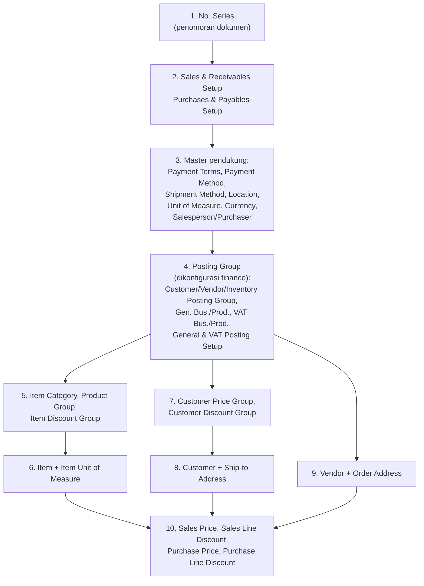
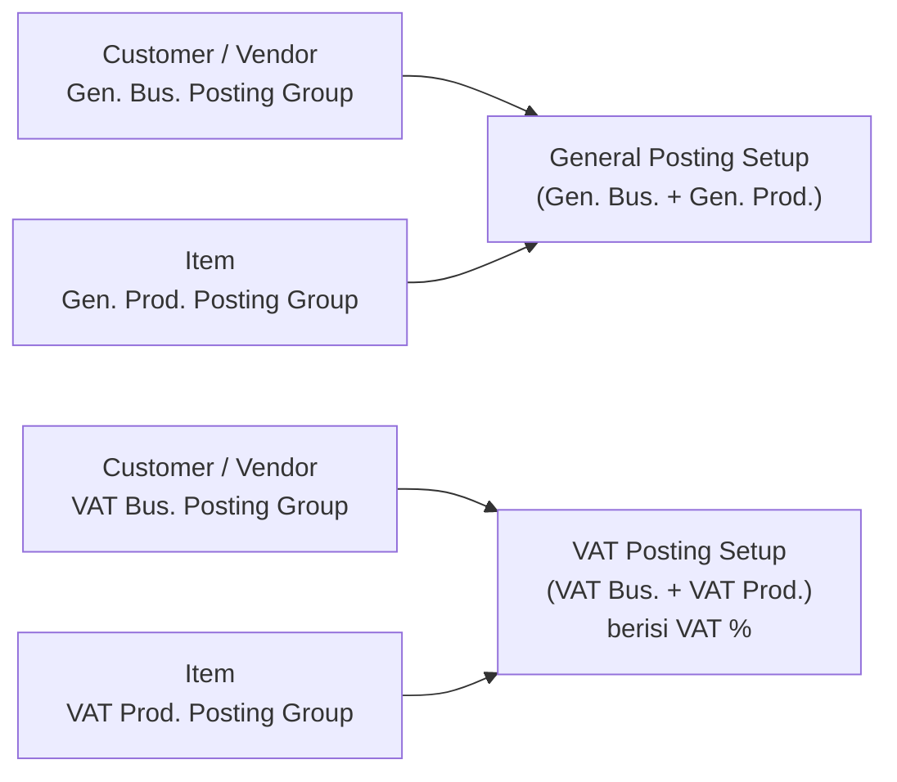
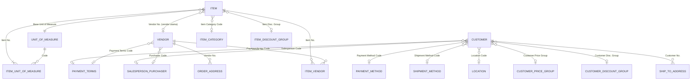

# Master Data dan Setup Dasar (NAV 2017)

> Pasangan ERPNext: Item, Customer, Supplier, Warehouse, Payment Terms, Naming Series, Selling/Buying Settings.

> Cakupan: hanya data yang dibutuhkan oleh **Purchasing Flow** dan **Selling Flow**. Detail akun dan costing tidak dibahas.

---

## 1. Urutan Penyiapan Data

Transaksi pertama baru bisa diposting jika data dasar berikut tersedia. Urutan di bawah mengikuti ketergantungan antartabel.

---

## 2. Setup Penomoran dan Pengaturan Modul

### 2.1 No. Series (padanan Naming Series)

| Tabel | Isi |
|-------|-----|
| **No. Series (308)** | `Code`, `Description`, `Default Nos.`, `Manual Nos.`, `Date Order` |
| **No. Series Line (309)** | `Series Code`, `Line No.`, `Starting Date`, `Starting No.`, `Ending No.`, `Warning No.`, `Increment-by No.`, `Last No. Used`, `Open` |

Cara kerja singkat:
- `Default Nos.` = dicentang jika nomor otomatis (tanpa input manual).
- `Manual Nos.` = dicentang jika pengguna boleh mengetik nomor sendiri.
- Satu series bisa punya beberapa baris berdasarkan `Starting Date` (misalnya reset tahunan).

Contoh series yang lazim dibuat:

| Code | Description | Starting No. | Dipakai untuk |
|------|-------------|--------------|---------------|
| `C` | Customer | C00001 | Customer Nos. |
| `V` | Vendor | V00001 | Vendor Nos. |
| `S-QUO` | Sales Quote | SQ-00001 | Quote Nos. (penjualan) |
| `S-ORD` | Sales Order | SO-00001 | Order Nos. (penjualan) |
| `S-SHPT+` | Posted Sales Shipment | PSH-00001 | Posted Shipment Nos. |
| `S-INV+` | Posted Sales Invoice | PSI-00001 | Posted Invoice Nos. |
| `P-ORD` | Purchase Order | PO-00001 | Order Nos. (pembelian) |
| `P-RCPT` | Posted Purchase Receipt | PPR-00001 | Posted Receipt Nos. |
| `P-INV+` | Posted Purchase Invoice | PPI-00001 | Posted Invoice Nos. |

### 2.2 Sales & Receivables Setup (311)

Cari lewat **Search → Sales & Receivables Setup**.

| Field | Fungsi |
|-------|--------|
| `Customer Nos.` | Series untuk Customer baru |
| `Quote Nos.` / `Blanket Order Nos.` / `Order Nos.` / `Return Order Nos.` | Series untuk dokumen kerja per `Document Type` |
| `Invoice Nos.` / `Credit Memo Nos.` | Series untuk dokumen *Sales Invoice* / *Sales Credit Memo* (langsung, tanpa Order) |
| `Posted Shipment Nos.` / `Posted Invoice Nos.` / `Posted Credit Memo Nos.` / `Posted Return Receipt Nos.` | Series untuk dokumen terposting |
| `Credit Warnings` | Peringatan saat input: *Both Warnings, Credit Limit, Overdue Balance, No Warning* |
| `Stockout Warning` | Peringatan jika qty melebihi stok tersedia |
| `Shipment on Invoice` | Jika dicentang, posting *Sales Invoice* langsung membuat Posted Sales Shipment |
| `Return Receipt on Credit Memo` | Idem untuk Sales Credit Memo → Return Receipt |
| `Calc. Inv. Discount` | Hitung invoice discount otomatis |
| `Archive Quotes and Orders` | Arsipkan Quote/Order saat dihapus atau selesai |
| `Default Posting Date` | `Work Date` atau `No Date` |
| `Default Qty. to Ship` | `Remainder` (isi otomatis sisa) atau `Blank` (isi manual) |
| `Ext. Doc. No. Mandatory` | Wajib isi `External Document No.` (misalnya nomor PO pelanggan) |

### 2.3 Purchases & Payables Setup (312)

Cari lewat **Search → Purchases & Payables Setup**.

| Field | Fungsi |
|-------|--------|
| `Vendor Nos.` | Series untuk Vendor baru |
| `Quote Nos.` / `Blanket Order Nos.` / `Order Nos.` / `Return Order Nos.` | Series dokumen kerja pembelian |
| `Invoice Nos.` / `Credit Memo Nos.` | Series untuk *Purchase Invoice* / *Purchase Credit Memo* langsung |
| `Posted Receipt Nos.` / `Posted Invoice Nos.` / `Posted Credit Memo Nos.` / `Posted Return Shpt. Nos.` | Series dokumen terposting |
| `Receipt on Invoice` | Posting *Purchase Invoice* langsung membuat Posted Purchase Receipt |
| `Return Shipment on Credit Memo` | Idem untuk Purchase Credit Memo → Return Shipment |
| `Ext. Doc. No. Mandatory` | Wajib isi `Vendor Invoice No.` / `Vendor Cr. Memo No.` |
| `Calc. Inv. Discount` | Hitung invoice discount otomatis |
| `Default Qty. to Receive` | `Remainder` atau `Blank` |
| `Invoice Rounding` / `Allow VAT Difference` | Pembulatan dan toleransi selisih pajak |

---

## 3. Item (Barang)

Cari lewat **Search → Items**, lalu **New**.

### 3.1 Field Penting pada Item Card (27)

| Kelompok | Field | Keterangan |
|----------|-------|------------|
| Umum | `No.` | Kode barang (otomatis atau manual sesuai series) |
| | `Description` | Nama barang |
| | `Type` | `Inventory` (barang stok) atau `Service` (jasa, tanpa stok) |
| | `Base Unit of Measure` | Satuan dasar. Setelah ada transaksi, **sebaiknya tidak diubah** |
| | `Item Category Code`, `Product Group Code` | Klasifikasi barang |
| | `Blocked` | Jika dicentang, barang tidak bisa dipakai di transaksi |
| Penagihan | `Costing Method` | FIFO, LIFO, Specific, Average, Standard (detail costing di luar cakupan) |
| | `Unit Cost` | Biaya per satuan (diisi manual untuk Standard, otomatis untuk metode lain) |
| | `Unit Price` | **Harga jual standar** (cadangan jika tidak ada Sales Price yang cocok) |
| | `Price/Profit Calculation` | Cara hitung hubungan harga, profit %, dan cost |
| | `Gen. Prod. Posting Group` | Wajib untuk transaksi |
| | `VAT Prod. Posting Group` | Wajib untuk transaksi |
| | `Inventory Posting Group` | Wajib untuk `Type = Inventory` |
| | `Item Disc. Group` | Kelompok diskon barang (dipakai di **Sales Line Discount**, lihat file 04) |
| | `Allow Invoice Disc.` | Apakah barang ikut dalam perhitungan invoice discount |
| Replenishment | `Vendor No.` | Vendor utama |
| | `Vendor Item No.` | Kode barang di sisi vendor |
| | `Replenishment System` | `Purchase`, `Prod. Order`, atau `Assembly` |
| Satuan | `Sales Unit of Measure` | Satuan default pada Sales Line |
| | `Purchase Unit of Measure` | Satuan default pada Purchase Line |

> Pengelompokan FastTab di layar dapat sedikit berbeda antarbuild. Yang penting adalah nama field-nya.

> **Item Tracking (lot / serial / tanggal kedaluwarsa)** diatur lewat field `Item Tracking Code`. Fitur ini relevan untuk barang berumur simpan, tetapi pembahasannya di luar manual ini.

### 3.2 Unit of Measure dan Konversi

Padanan *UOM Conversion Detail* di ERPNext.

| Tabel | Fungsi |
|-------|--------|
| **Unit of Measure (204)** | Daftar satuan: `Code` (KG, SAK, KRG, PCS), `Description` |
| **Item Unit of Measure (5404)** | Satuan per Item: `Item No.`, `Code`, `Qty. per Unit of Measure` |

Contoh untuk item `BRS-5KG` dengan `Base Unit of Measure = KG`:

| Item No. | Code | Qty. per Unit of Measure |
|----------|------|--------------------------|
| BRS-5KG | KG | 1 |
| BRS-5KG | SAK | 25 |

Jika Purchase Line memakai `SAK` dengan `Quantity = 4`, maka `Quantity (Base)` = 4 × 25 = **100 KG**. Field `Qty. per Unit of Measure` disalin ke baris transaksi dan menjadi dasar konversi.

### 3.3 Pengelompokan Barang

| Tabel | Fungsi |
|-------|--------|
| **Item Category (5722)** | Kategori utama barang |
| **Product Group (5723)** | Subkelompok di bawah kategori (pada versi 2017) |
| **Item Discount Group (341)** | Kelompok untuk aturan diskon (bukan kategori laporan) |

### 3.4 Data Pelengkap Item

| Tabel | Fungsi | Padanan ERPNext |
|-------|--------|-----------------|
| **Item Vendor (99)** | Daftar vendor alternatif per item, lengkap dengan `Vendor Item No.` dan `Lead Time Calculation` | Item Supplier |
| **Item Cross Reference (5717)** | Kode item milik customer/vendor yang dipetakan ke kode item Anda | Item Customer Detail / Supplier Item Code |
| **Item Variant (5401)** | Varian (ukuran, warna) | Item Variant |

---

## 4. Customer (Pelanggan)

Cari lewat **Search → Customers**, lalu **New**.

### 4.1 Field Penting pada Customer Card (18)

| Kelompok | Field | Keterangan |
|----------|-------|------------|
| Umum | `No.`, `Name`, `Address`, `City`, `Phone No.`, `E-Mail` | Identitas |
| | `Salesperson Code` | Sales yang menangani |
| | `Blocked` | `(kosong)`, `Ship`, `Invoice`, atau `All` |
| | `Credit Limit (LCY)` | Batas piutang; dicek sesuai `Credit Warnings` |
| Penagihan | `Bill-to Customer No.` | Jika tagihan dikirim ke customer lain (kantor pusat) |
| | `Customer Posting Group` | Wajib |
| | `Gen. Bus. Posting Group` | Wajib |
| | `VAT Bus. Posting Group` | Wajib |
| | **`Customer Price Group`** | Kelompok harga (lihat file 04) |
| | **`Customer Disc. Group`** | Kelompok diskon (lihat file 04) |
| | `Allow Line Disc.` | Izinkan diskon baris untuk customer ini |
| | `Invoice Disc. Code` | Kode tabel diskon faktur (`Cust. Invoice Disc.`) |
| | `Prices Including VAT` | Harga di dokumen sudah termasuk pajak |
| Pembayaran | `Payment Terms Code` | Syarat pembayaran |
| | `Payment Method Code` | Metode bayar |
| | `Application Method` | `Manual` atau `Apply to Oldest` (cara pelunasan invoice) |
| Pengiriman | `Location Code` | Gudang default |
| | `Shipment Method Code` | Metode pengiriman |
| | `Combine Shipments` | Boleh digabung saat penagihan massal |
| Perdagangan luar negeri | `Currency Code` | Kosong = mata uang lokal (LCY) |

### 4.2 Data Pelengkap Customer

| Tabel | Fungsi |
|-------|--------|
| **Ship-to Address (222)** | Alamat kirim tambahan per customer (`Customer No.` + `Code`) |
| **Customer Bank Account** | Rekening bank customer |
| **Cust. Invoice Disc. (19)** | Aturan diskon faktur berdasarkan nilai minimal |

---

## 5. Vendor (Pemasok)

Cari lewat **Search → Vendors**, lalu **New**.

### 5.1 Field Penting pada Vendor Card (23)

| Kelompok | Field | Keterangan |
|----------|-------|------------|
| Umum | `No.`, `Name`, `Address`, `Phone No.` | Identitas |
| | `Purchaser Code` | Petugas pembelian |
| | `Blocked` | `(kosong)`, `Payment`, atau `All` |
| Penagihan | `Pay-to Vendor No.` | Jika pembayaran ke vendor lain |
| | `Vendor Posting Group` | Wajib |
| | `Gen. Bus. Posting Group` | Wajib |
| | `VAT Bus. Posting Group` | Wajib |
| | `Invoice Disc. Code` | Kode diskon faktur vendor |
| | `Prices Including VAT` | Harga vendor sudah termasuk pajak |
| Pembayaran | `Payment Terms Code`, `Payment Method Code` | Syarat dan metode bayar |
| | `Application Method` | `Manual` atau `Apply to Oldest` |
| Penerimaan | `Location Code` | Gudang penerimaan default |
| | `Lead Time Calculation` | Estimasi waktu kirim vendor |
| | `Currency Code` | Kosong = mata uang lokal |

### 5.2 Data Pelengkap Vendor

| Tabel | Fungsi |
|-------|--------|
| **Order Address (224)** | Alamat vendor alternatif untuk Purchase Order |
| **Vendor Bank Account** | Rekening bank vendor |
| **Vendor Invoice Disc. (24)** | Aturan diskon faktur vendor |

> **Catatan:** NAV standar **tidak** memiliki *Vendor Price Group* maupun *Vendor Discount Group*. Harga dan diskon pembelian diatur per vendor lewat **Purchase Price** dan **Purchase Line Discount** (lihat file 02 dan 04).

---

## 6. Master Pendukung

| Tabel | Field utama | Fungsi |
|-------|-------------|--------|
| **Payment Terms (3)** | `Code`, `Due Date Calculation`, `Discount Date Calculation`, `Discount %` | Menghitung `Due Date` dokumen. Contoh: `30D` = jatuh tempo 30 hari |
| **Payment Method (289)** | `Code`, `Description` | Metode pembayaran (tunai, transfer) |
| **Shipment Method (10)** | `Code`, `Description` | Cara pengiriman (FOB, CIF, dll.) |
| **Location (14)** | `Code`, `Name`, `Require Receive`, `Require Shipment`, `Require Put-away`, `Require Pick`, `Bin Mandatory` | Gudang. Flow di manual ini mengasumsikan `Require *` **tidak dicentang** (proses sederhana) |
| **Salesperson/Purchaser (13)** | `Code`, `Name`, `Commission %` | Pelaksana penjualan/pembelian |
| **Currency (4)** | `Code`, `Description` (+ Exchange Rate) | Mata uang asing |
| **VAT Posting Setup (325)** | `VAT Bus. Posting Group`, `VAT Prod. Posting Group`, `VAT %`, `VAT Calculation Type` | Persentase dan jenis hitung pajak |

> **Catatan Location:** Jika `Require Receive` / `Require Shipment` dicentang, NAV mewajibkan dokumen gudang (*Warehouse Receipt* / *Warehouse Shipment*) sebelum posting. Itu masuk ke Warehouse Management dan tidak dibahas di sini.

---

## 7. Posting Group (Hanya sebagai Prasyarat)

Tabel berikut harus sudah **terisi oleh tim finance** agar transaksi dapat diposting. Isi akunnya tidak dibahas di manual ini.

| Posting Group | Dipakai oleh | Tabel |
|---------------|--------------|-------|
| `Customer Posting Group` | Customer | Customer Posting Group (92) |
| `Vendor Posting Group` | Vendor | Vendor Posting Group (93) |
| `Inventory Posting Group` | Item | Inventory Posting Group (94) |
| `Gen. Bus. Posting Group` | Customer, Vendor | Gen. Business Posting Group (250) |
| `Gen. Prod. Posting Group` | Item | Gen. Product Posting Group (251) |
| `VAT Bus. Posting Group` | Customer, Vendor | VAT Business Posting Group (323) |
| `VAT Prod. Posting Group` | Item | VAT Product Posting Group (324) |

Pasangan yang harus tersedia saat posting:

---

## 8. Relasi Tabel Master

### 8.1 Daftar Relasi (TableRelation)

| Dari (Tabel.Field) | Ke (Tabel.Field) | Keterangan |
|--------------------|------------------|------------|
| Customer.`Payment Terms Code` | Payment Terms.`Code` | |
| Customer.`Payment Method Code` | Payment Method.`Code` | |
| Customer.`Shipment Method Code` | Shipment Method.`Code` | |
| Customer.`Location Code` | Location.`Code` | |
| Customer.`Salesperson Code` | Salesperson/Purchaser.`Code` | |
| Customer.`Currency Code` | Currency.`Code` | |
| Customer.`Customer Price Group` | Customer Price Group.`Code` | |
| Customer.`Customer Disc. Group` | Customer Discount Group.`Code` | |
| Customer.`Bill-to Customer No.` | Customer.`No.` | Relasi ke diri sendiri |
| Ship-to Address.`Customer No.` | Customer.`No.` | 1 customer, banyak alamat kirim |
| Vendor.`Payment Terms Code` | Payment Terms.`Code` | |
| Vendor.`Purchaser Code` | Salesperson/Purchaser.`Code` | |
| Vendor.`Pay-to Vendor No.` | Vendor.`No.` | Relasi ke diri sendiri |
| Order Address.`Vendor No.` | Vendor.`No.` | |
| Item.`Base Unit of Measure` | Unit of Measure.`Code` | |
| Item.`Item Category Code` | Item Category.`Code` | |
| Item.`Product Group Code` | Product Group.`Code` (dengan Item Category Code) | |
| Item.`Item Disc. Group` | Item Discount Group.`Code` | |
| Item.`Vendor No.` | Vendor.`No.` | Vendor utama |
| Item Unit of Measure.`Item No.` | Item.`No.` | 1 item, banyak satuan |
| Item Unit of Measure.`Code` | Unit of Measure.`Code` | |
| Item Vendor.`Item No.` / `Vendor No.` | Item.`No.` / Vendor.`No.` | |

### 8.2 ER Diagram Master

---

## 9. Checklist Sebelum Transaksi Pertama

**Setup**

- [ ] `No. Series` dan `No. Series Line` untuk semua dokumen
- [ ] `Sales & Receivables Setup` dan `Purchases & Payables Setup` terisi
- [ ] Posting Group, `General Posting Setup`, dan `VAT Posting Setup` lengkap (finance)
- [ ] Rentang tanggal posting yang diizinkan (`Allow Posting From/To` pada `General Ledger Setup` atau `User Setup`) mencakup tanggal transaksi

**Master**

- [ ] `Location` untuk gudang yang dipakai
- [ ] Item lengkap: `Base Unit of Measure`, tiga Posting Group, `Item Disc. Group` (jika dipakai)
- [ ] `Item Unit of Measure` untuk satuan beli/jual selain satuan dasar
- [ ] Customer lengkap: Posting Group, `Payment Terms Code`, `Customer Price Group`, `Customer Disc. Group`
- [ ] Vendor lengkap: Posting Group, `Payment Terms Code`

**Harga dan diskon (opsional namun umum)**

- [ ] `Sales Price` / `Sales Line Discount` (file 04)
- [ ] `Purchase Price` / `Purchase Line Discount` (file 02 dan 04)

---

## 10. Perbandingan Singkat dengan ERPNext

| Topik | ERPNext | NAV 2017 |
|-------|---------|----------|
| Konversi satuan | Child table di Item | Tabel terpisah `Item Unit of Measure` |
| Pajak | Tax Template di dokumen | `VAT Bus.` × `VAT Prod. Posting Group` → `VAT Posting Setup` |
| Akun | Default account di Item Group / Company | Lewat `General Posting Setup` (kombinasi posting group) |
| Harga | Price List (berisi banyak Item Price) | Tabel `Sales Price` dengan `Sales Type` (Customer / Customer Price Group / All Customers / Campaign) |
| Kelompok customer | Satu `Customer Group` | **Dua** kelompok: `Customer Price Group` dan `Customer Disc. Group` |
| Kelompok barang | Item Group (hierarki) | `Item Category` + `Product Group`, serta `Item Discount Group` khusus diskon |
| Blokir | `Disabled` / Frozen | `Blocked` (customer: Ship/Invoice/All; vendor: Payment/All) |

---

*Sebelumnya: [Overview](../introduction/pengantar-dan-pemetaan-erpnext.md) · Lanjut ke: [Transaction](../transaction/purchase-flow.md)*