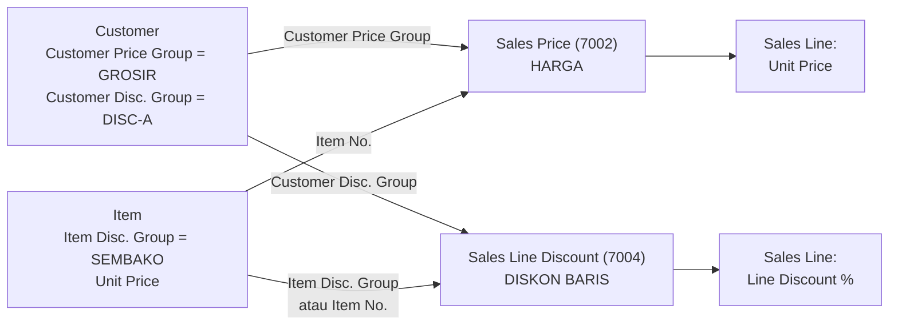
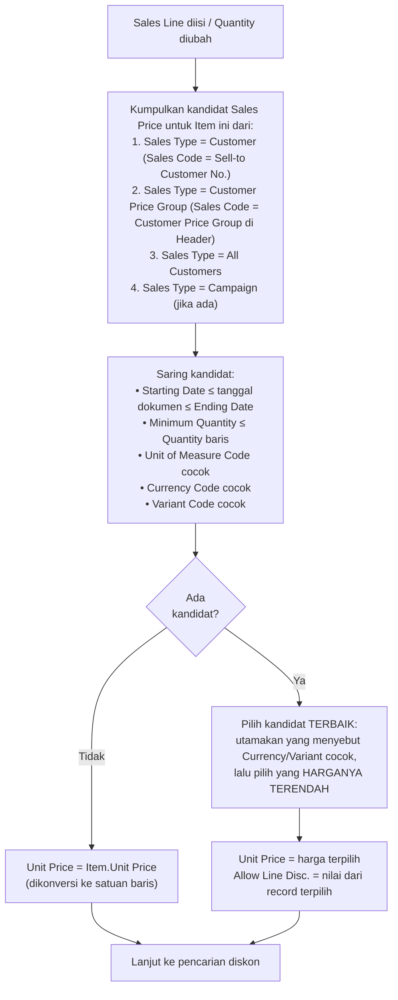
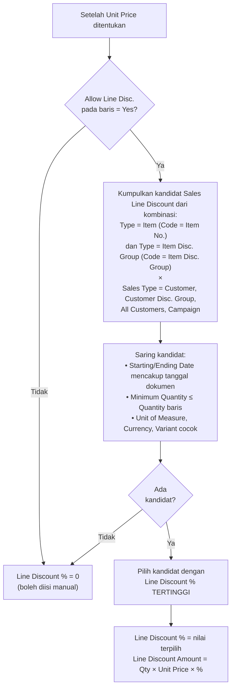
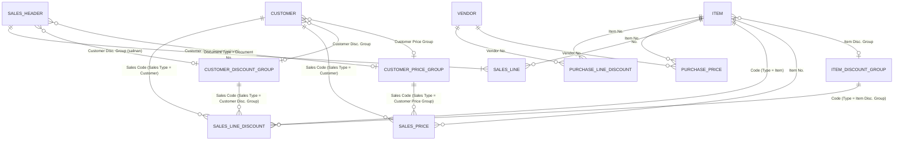

# Customer Price Group, Customer Discount Group, dan Mekanisme Harga NAV 2017

> Pasangan ERPNext: Customer Group + Price List (Item Price) + Pricing Rule.
> Di NAV, kedua fungsi itu dipecah: **harga** diatur lewat *Customer Price Group* + *Sales Price*, sedangkan **diskon** diatur lewat *Customer Discount Group* + *Item Discount Group* + *Sales Line Discount*.

---

## 1. Konsep Dasar

Ada tiga jenis "kelompok" yang berbeda tujuan. Ketiganya sering tertukar oleh pemula.

| Kelompok | Dipasang di | Tujuan | Dipakai oleh |
|----------|-------------|--------|--------------|
| **Customer Price Group** (6) | Customer | Mengelompokkan customer yang mendapat **harga** sama | `Sales Price` |
| **Customer Discount Group** (340) | Customer | Mengelompokkan customer yang mendapat **diskon** sama | `Sales Line Discount` |
| **Item Discount Group** (341) | Item | Mengelompokkan barang yang mendapat **diskon** sama | `Sales Line Discount` |

Dua kelompok customer ini **independen**. Satu customer bisa berada di price group `GROSIR` dan discount group `DISC-A` sekaligus. Customer lain bisa di price group yang sama namun discount group berbeda.

Selain diskon baris, NAV juga mengenal **diskon faktur** (*Invoice Discount*) yang dihitung berdasarkan total dokumen, bukan per baris. Dibahas singkat di bagian 6.

---

## 2. Struktur Tabel

### 2.1 Customer Price Group (6)

| Field | Fungsi |
|-------|--------|
| `Code` | Kode kelompok (misalnya `GROSIR`, `RETAIL`, `AGEN`) |
| `Description` | Keterangan |
| `Allow Line Disc.` | Jika dicentang, customer di kelompok ini boleh mendapat diskon baris |
| `Allow Invoice Disc.` | Jika dicentang, customer di kelompok ini boleh mendapat diskon faktur |
| `Price Includes VAT` | Harga pada kelompok ini sudah termasuk pajak |
| `VAT Bus. Posting Gr. (Price)` | Kode pajak untuk memecah harga yang sudah termasuk pajak |

Tabel ini hanya "label". Harga sesungguhnya disimpan di **Sales Price**.

### 2.2 Customer Discount Group (340) dan Item Discount Group (341)

| Field | Fungsi |
|-------|--------|
| `Code` | Kode kelompok (misalnya `DISC-A`, `SEMBAKO`) |
| `Description` | Keterangan |

Keduanya hanya "label". Persentase diskon disimpan di **Sales Line Discount**.

### 2.3 Sales Price (7002)

| Field | Fungsi |
|-------|--------|
| `Item No.` | Item yang diberi harga |
| `Sales Type` | `Customer` / `Customer Price Group` / `All Customers` / `Campaign` |
| `Sales Code` | Kode customer, kode price group, atau kode campaign (kosong untuk `All Customers`) |
| `Currency Code` | Mata uang harga (kosong = lokal) |
| `Starting Date`, `Ending Date` | Periode berlaku (kosong = tanpa batas) |
| `Minimum Quantity` | Qty minimal agar harga berlaku (*quantity break*) |
| `Unit of Measure Code` | Harga per satuan ini (kosong = `Base Unit of Measure`) |
| `Variant Code` | Varian item (bila dipakai) |
| `Unit Price` | **Harga jual** |
| `Price Includes VAT` | Harga termasuk pajak |
| `Allow Invoice Disc.` | Ikut diskon faktur |
| `Allow Line Disc.` | Boleh diberi diskon baris |
| `VAT Bus. Posting Gr. (Price)` | Kode pajak untuk harga termasuk pajak |

### 2.4 Sales Line Discount (7004)

| Field | Fungsi |
|-------|--------|
| `Type` | `Item` atau `Item Disc. Group` |
| `Code` | Kode item atau kode item discount group (sesuai `Type`) |
| `Sales Type` | `Customer` / `Customer Disc. Group` / `All Customers` / `Campaign` |
| `Sales Code` | Kode customer, kode discount group, atau kode campaign (kosong untuk `All Customers`) |
| `Currency Code` | Mata uang (kosong = lokal) |
| `Starting Date`, `Ending Date` | Periode berlaku |
| `Minimum Quantity` | Qty minimal agar diskon berlaku |
| `Unit of Measure Code` | Satuan acuan qty minimal |
| `Variant Code` | Varian item |
| `Line Discount %` | **Persentase diskon** |

### 2.5 Cust. Invoice Disc. (19) — Diskon Faktur

| Field | Fungsi |
|-------|--------|
| `Code` | Sesuai `Invoice Disc. Code` di Customer Card (default = nomor customer) |
| `Currency Code` | Mata uang |
| `Minimum Amount` | Nilai dokumen minimal |
| `Discount %` | Persentase diskon faktur |
| `Service Charge` | Biaya layanan tetap (opsional) |

---

## 3. Cara Setup (Langkah demi Langkah)

> Gunakan **Search** di pojok kanan atas untuk membuka halaman-halaman berikut.

### Langkah 1 — Buat Customer Price Group

1. **Search → Customer Price Groups → New.**
2. Isi `Code = GROSIR`, `Description = Pelanggan Grosir`.
3. Atur `Allow Line Disc.`, `Allow Invoice Disc.`, dan `Price Includes VAT` sesuai kebijakan.
4. Ulangi untuk kelompok lain (`RETAIL`, `AGEN`, dst.).

### Langkah 2 — Buat Customer Discount Group

1. **Search → Customer Disc. Groups → New.**
2. Isi `Code = DISC-A`, `Description = Diskon Pelanggan A`.

### Langkah 3 — Buat Item Discount Group dan pasang di Item

1. **Search → Item Disc. Groups → New.** Isi `Code = SEMBAKO`.
2. Buka **Item Card** `BRS-5KG`, isi `Item Disc. Group = SEMBAKO`.

### Langkah 4 — Pasang kelompok di Customer

Buka **Customer Card** `C00010`, isi:
- `Customer Price Group = GROSIR`
- `Customer Disc. Group = DISC-A`
- `Allow Line Disc.` sesuai kebijakan

### Langkah 5 — Isi Sales Price

1. **Search → Sales Prices** (atau dari Item Card → *Prices* / dari Customer Price Group → *Sales Prices*).
2. Tambahkan baris sesuai kebutuhan, misalnya:

| Item No. | Sales Type | Sales Code | Min. Qty | UoM | Starting Date | Ending Date | Unit Price |
|----------|------------|------------|----------|-----|---------------|-------------|-----------|
| BRS-5KG | All Customers | *(kosong)* | 0 | SAK | 01-01-2026 | | 350.000 |
| BRS-5KG | Customer Price Group | GROSIR | 0 | SAK | 01-01-2026 | | 330.000 |
| BRS-5KG | Customer Price Group | GROSIR | 50 | SAK | 01-01-2026 | | 315.000 |
| BRS-5KG | Customer | C00010 | 0 | SAK | 01-10-2026 | 31-12-2026 | 325.000 |

### Langkah 6 — Isi Sales Line Discount

1. **Search → Sales Line Discounts** (atau dari Item Card → *Line Discounts*).
2. Tambahkan baris, misalnya:

| Type | Code | Sales Type | Sales Code | Min. Qty | Line Discount % |
|------|------|------------|------------|----------|-----------------|
| Item | BRS-5KG | All Customers | *(kosong)* | 100 | 2 |
| Item Disc. Group | SEMBAKO | Customer Disc. Group | DISC-A | 0 | 3 |
| Item Disc. Group | SEMBAKO | Customer Disc. Group | DISC-A | 50 | 5 |
| Item | BRS-5KG | Customer | C00010 | 0 | 4 |

### Langkah 7 — Uji

Buat Sales Order uji untuk `C00010`, isi baris `BRS-5KG` dengan `Quantity` berbeda-beda, dan perhatikan `Unit Price` serta `Line Discount %`.

---

## 4. Algoritma Pencarian

Pencarian terjadi saat Anda mengisi atau mengubah `No.`, `Quantity`, `Unit of Measure Code` pada Sales Line (dan saat tanggal/customer pada header di-*validate*).

### 4.1 Harga (Sales Price)

**Poin yang perlu diingat (khususnya bagi pengguna ERPNext):**

1. **Tidak ada prioritas kaku** seperti "harga khusus customer selalu menang". Semua kandidat valid dari ketiga sumber (Customer, Customer Price Group, All Customers) dikumpulkan bersama, lalu dipilih **yang terendah**. Jika harga khusus customer lebih tinggi dari harga price group, harga price group yang dipakai.
2. Satu-satunya cara "memaksa" harga yang lebih tinggi adalah dengan **membatasi periode atau qty minimal** sehingga kandidat lain tidak berlaku, atau menghapus kandidat yang lebih rendah.
3. Jika tidak ada satu pun Sales Price yang cocok, harga **jatuh ke `Unit Price` di Item Card**.
4. Harga dihitung pada saat baris diisi dan tersimpan di baris. Mengubah Sales Price kemudian **tidak** mengubah baris yang sudah ada.

> Perilaku "harga terendah menang" adalah perilaku standar NAV. Selalu uji dengan data Anda di database test, karena customization partner bisa mengubahnya.

### 4.2 Diskon Baris (Sales Line Discount)

**Perbedaan penting:** untuk harga, NAV memilih yang **terendah**. Untuk diskon baris, NAV memilih yang **tertinggi**. Diskon dari beberapa sumber **tidak dijumlahkan** (tidak bertumpuk); hanya satu persentase terbaik yang dipakai.

---

## 5. Contoh Perhitungan Lengkap

**Data** (sesuai tabel pada bagian 3):
- Customer `C00010`: `Customer Price Group = GROSIR`, `Customer Disc. Group = DISC-A`
- Item `BRS-5KG`: `Item Disc. Group = SEMBAKO`, `Unit Price` di Item Card = 14.000 per KG (setara 350.000 per SAK)
- Semua baris Sales Price dan Sales Line Discount memakai `Allow Line Disc.` = Yes
- Satuan baris: SAK

### Kasus A — Qty 20 SAK, tanggal dokumen 15-11-2026

**Harga:**

| Kandidat | Sales Type | Min. Qty | Berlaku? | Harga |
|----------|------------|----------|----------|-------|
| 1 | All Customers | 0 | Ya | 350.000 |
| 2 | Customer Price Group GROSIR | 0 | Ya | 330.000 |
| 3 | Customer Price Group GROSIR | 50 | **Tidak** (20 < 50) | 315.000 |
| 4 | Customer C00010 | 0 | Ya (15-11-2026 dalam periode) | 325.000 |

→ **Harga terendah dari yang valid = 325.000** (kandidat 4).

**Diskon:**

| Kandidat | Type / Sales Type | Min. Qty | Berlaku? | % |
|----------|-------------------|----------|----------|---|
| a | Item BRS-5KG / All Customers | 100 | **Tidak** | 2 |
| b | Item Disc. Group SEMBAKO / Customer Disc. Group DISC-A | 0 | Ya | 3 |
| c | Item Disc. Group SEMBAKO / Customer Disc. Group DISC-A | 50 | **Tidak** | 5 |
| d | Item BRS-5KG / Customer C00010 | 0 | Ya | 4 |

→ **Diskon tertinggi dari yang valid = 4%** (kandidat d).

**Hasil baris:**
- Gross = 20 × 325.000 = **6.500.000**
- Line Discount Amount = 4% × 6.500.000 = **260.000**
- `Line Amount` = **6.240.000**

### Kasus B — Qty 60 SAK, tanggal dokumen 15-11-2026

**Harga:** kandidat 1 (350.000), 2 (330.000), 3 (315.000, karena 60 ≥ 50), dan 4 (325.000) semuanya valid → **terendah = 315.000** (kandidat 3, price group GROSIR dengan *quantity break*).

**Diskon:** b (3%), c (5%, karena 60 ≥ 50), d (4%) valid; a tidak (60 < 100) → **tertinggi = 5%** (kandidat c).

**Hasil baris:**
- Gross = 60 × 315.000 = **18.900.000**
- Line Discount Amount = 5% × 18.900.000 = **945.000**
- `Line Amount` = **17.955.000**

### Kasus C — Qty 20 SAK, tanggal dokumen 15-01-2027

Harga khusus customer (kandidat 4) sudah **kedaluwarsa** (Ending Date 31-12-2026). Kandidat valid: 1 (350.000) dan 2 (330.000) → **harga = 330.000**. Diskon: kandidat b (3%) dan d (4%) tidak memiliki tanggal akhir, sehingga tetap berlaku → **diskon = 4%**.

- Gross = 20 × 330.000 = 6.600.000
- Diskon 4% = 264.000
- `Line Amount` = **6.336.000**

### Ringkasan Hasil

| Kasus | Qty | Tanggal | Unit Price | Disc % | Line Amount |
|-------|-----|---------|-----------|--------|-------------|
| A | 20 | 15-11-2026 | 325.000 | 4 | 6.240.000 |
| B | 60 | 15-11-2026 | 315.000 | 5 | 17.955.000 |
| C | 20 | 15-01-2027 | 330.000 | 4 | 6.336.000 |

---

## 6. Faktor Lain yang Mempengaruhi

| Faktor | Pengaruh |
|--------|----------|
| **Allow Line Disc.** | Jika `No` pada baris, diskon baris tidak diberikan otomatis. Nilai awalnya diambil dari Customer Price Group (bila customer punya), atau dari Customer Card. Setelah harga ditemukan, nilai dari record Sales Price terpilih dapat menimpanya |
| **Allow Invoice Disc.** | Mengatur apakah baris ikut dasar perhitungan diskon faktur. Ditentukan oleh Item, Customer Price Group, dan record Sales Price |
| **Diskon faktur (Cust. Invoice Disc.)** | Dihitung terhadap total dokumen setelah diskon baris. Aktif lewat `Calculate Invoice Discount` atau `Calc. Inv. Discount` di setup. Berdasarkan `Invoice Disc. Code` Customer dan `Minimum Amount` |
| **Prices Including VAT** | Jika customer/price group memakai harga termasuk pajak, NAV menyesuaikan `Unit Price` dengan `VAT Bus. Posting Gr. (Price)`. Pastikan konsisten antara header dan Sales Price |
| **Campaign** | Sales Type `Campaign` memberi harga/diskon khusus untuk kampanye pemasaran (opsional) |
| **Currency Code** | Record tanpa Currency Code berlaku untuk mata uang lokal; harga mata uang asing perlu record dengan `Currency Code` sama |
| **Satuan (UoM)** | Record dengan `Unit of Measure Code` terisi hanya cocok jika baris memakai satuan yang sama |
| **Edit manual** | `Unit Price` dan `Line Discount %` pada baris boleh ditimpa manual selama dokumen belum diposting |

### Pemeliharaan Harga Massal

**Sales Price Worksheet** (**Search → Sales Price Worksheet**) memudahkan perubahan harga massal. Anda dapat menarik harga yang ada (*Suggest Item Price on Wksh.*), mengubahnya, lalu menerapkannya (*Implement Price Change*). Ini setara dengan impor/ubah massal Item Price di ERPNext.

---

## 7. Daftar Periksa: Mengapa Harga atau Diskon Tidak Muncul?

| No | Pemeriksaan | Keterangan |
|----|-------------|------------|
| 1 | Customer Card terisi `Customer Price Group` / `Customer Disc. Group`? | Jika kosong, record dengan Sales Type group tidak akan cocok |
| 2 | Header dokumen berisi kelompok yang benar? | Header menyalin kelompok saat customer dipilih. Jika Customer Card diubah setelah dokumen dibuat, validasi ulang `Sell-to Customer No.` atau ubah kelompok di header |
| 3 | `Starting Date` ≤ tanggal dokumen ≤ `Ending Date`? | Cek `Order Date` / `Posting Date` sesuai tanggal yang dipakai NAV pada dokumen tersebut |
| 4 | `Minimum Quantity` terpenuhi? | Qty baris harus ≥ qty minimal |
| 5 | `Unit of Measure Code` sama? | Record bersatuan SAK tidak cocok dengan baris bersatuan KG |
| 6 | `Currency Code` sama? | Dokumen mata uang asing butuh record dengan mata uang tersebut |
| 7 | `Item Disc. Group` terisi di Item Card? | Tanpa itu, record bertipe `Item Disc. Group` tidak dapat cocok |
| 8 | `Allow Line Disc.` = Yes (Customer / Customer Price Group / Sales Price)? | Jika No, diskon baris tidak diberikan otomatis |
| 9 | Ada harga lain yang lebih rendah? | Ingat: harga terendah yang menang |
| 10 | Harga diubah setelah baris dibuat? | Baris lama tidak otomatis ter-update. Isi ulang `No.` atau `Quantity` agar dihitung ulang |
| 11 | `Prices Including VAT` konsisten? | Header, Customer Price Group, dan Sales Price harus selaras |
| 12 | Tidak ada Sales Price sama sekali? | Harga jatuh ke `Unit Price` di Item Card |

---

## 8. Relasi Tabel Harga dan Diskon

### 8.1 Daftar Relasi

| Dari (Tabel.Field) | Ke (Tabel.Field) | Keterangan |
|--------------------|------------------|------------|
| Customer.`Customer Price Group` | Customer Price Group.`Code` | |
| Customer.`Customer Disc. Group` | Customer Discount Group.`Code` | |
| Item.`Item Disc. Group` | Item Discount Group.`Code` | |
| Sales Header.`Customer Price Group` | Customer Price Group.`Code` | Salinan dari Customer |
| Sales Header.`Customer Disc. Group` | Customer Discount Group.`Code` | Salinan dari Customer |
| Sales Price.`Item No.` | Item.`No.` | |
| Sales Price.`Sales Code` | Customer.`No.` / Customer Price Group.`Code` / Campaign.`No.` | Bergantung `Sales Type`; kosong untuk `All Customers` |
| Sales Price.`Currency Code` | Currency.`Code` | |
| Sales Price.`Unit of Measure Code` | Item Unit of Measure.(`Item No.`, `Code`) | |
| Sales Line Discount.`Code` | Item.`No.` / Item Discount Group.`Code` | Bergantung `Type` |
| Sales Line Discount.`Sales Code` | Customer.`No.` / Customer Discount Group.`Code` / Campaign.`No.` | Bergantung `Sales Type`; kosong untuk `All Customers` |
| Sales Line Discount.`Unit of Measure Code` | Item Unit of Measure.(`Item No.`, `Code`) | |
| Cust. Invoice Disc.`Code` | Customer.`Invoice Disc. Code` | |
| Purchase Price.`Item No.` / `Vendor No.` | Item.`No.` / Vendor.`No.` | Pembelian: per vendor, tanpa group |
| Purchase Line Discount.`Item No.` / `Vendor No.` | Item.`No.` / Vendor.`No.` | Pembelian: per vendor, tanpa group |

### 8.2 ER Diagram

---

## 9. Sisi Pembelian: Tidak Ada Group

NAV standar tidak memiliki *Vendor Price Group* atau *Vendor Discount Group*. Untuk pembelian:

| Kebutuhan | Cara di NAV |
|-----------|-------------|
| Harga beda per vendor | `Purchase Price` dengan `Vendor No.` |
| Harga bertingkat per qty | `Purchase Price` dengan `Minimum Quantity` |
| Harga per periode | `Starting Date` / `Ending Date` |
| Diskon per vendor | `Purchase Line Discount` |
| Diskon total faktur | `Vendor Invoice Disc.` |

Pencarian di sisi pembelian mengikuti pola serupa dengan penjualan (saring berdasarkan tanggal, qty minimal, satuan, mata uang; pilih yang paling menguntungkan). Jika tidak ada `Purchase Price` yang cocok, `Direct Unit Cost` diisi dari data default Item (umumnya `Last Direct Cost`).

---

## 10. Pemetaan Konsep ERPNext → NAV

| Kebutuhan | ERPNext | NAV 2017 |
|-----------|---------|----------|
| Kelompok customer | `Customer Group` (satu) | `Customer Price Group` **dan** `Customer Disc. Group` (dua, terpisah) |
| Daftar harga | `Price List` + `Item Price` | `Sales Price` (`Sales Type` menentukan siapa yang berhak) |
| Harga khusus customer | Item Price dengan field `Customer` | `Sales Price` dengan `Sales Type = Customer` |
| Harga per kelompok | Price List khusus untuk kelompok | `Sales Price` dengan `Sales Type = Customer Price Group` |
| Harga umum | Standard Selling Price List | `Sales Price` dengan `Sales Type = All Customers`, atau `Unit Price` di Item Card |
| Harga bertingkat per qty | Item Price `Min Qty` / Pricing Rule | `Minimum Quantity` pada `Sales Price` |
| Periode berlaku | `Valid From` / `Valid Upto` | `Starting Date` / `Ending Date` |
| Diskon per item / kelompok item | Pricing Rule (Apply On: Item Code / Item Group) | `Sales Line Discount` (`Type = Item` / `Item Disc. Group`) |
| Diskon per customer / kelompok | Pricing Rule (Applicable For: Customer / Customer Group) | `Sales Line Discount` (`Sales Type = Customer` / `Customer Disc. Group`) |
| Diskon bertumpuk | Bisa diatur (priority, "Apply Multiple Pricing Rules") | **Tidak bertumpuk**; diskon tertinggi yang berlaku saja |
| Konflik beberapa harga | Berdasarkan `Priority` | **Harga terendah** menang |
| Diskon total dokumen | Additional Discount | `Invoice Discount` (`Cust. Invoice Disc.`) |

---
