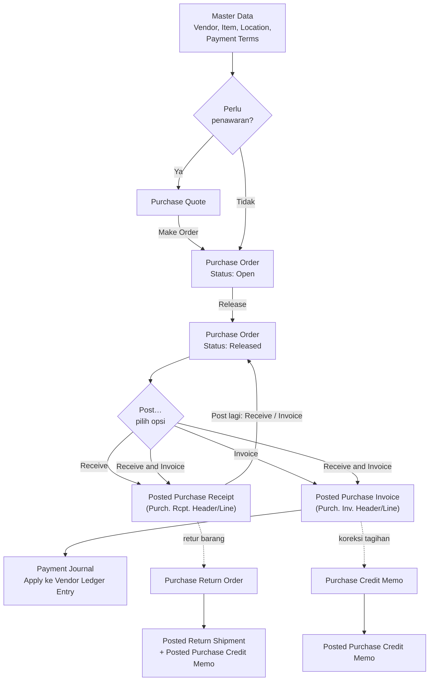
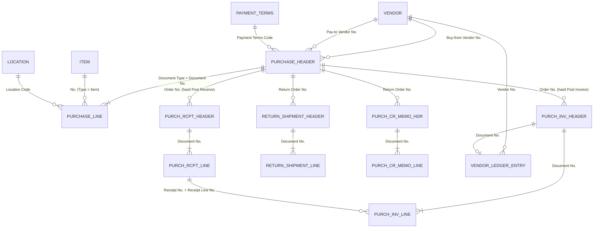

# Purchase Flow (Alur Pembelian) NAV 2017

> Pasangan ERPNext: Request for Quotation → Supplier Quotation → Purchase Order → Purchase Receipt → Purchase Invoice → Payment Entry → Purchase Return.
> Dikecualikan sesuai permintaan: entri akuntansi (G/L) dan pergerakan stok (Item Ledger / Value Entry).

---

## 1. Gambaran Alur

Catatan: pesanan yang **sudah diterima seluruhnya dan sudah ditagih seluruhnya** otomatis dihapus dari daftar Purchase Order (diarsipkan bila `Archive Orders` aktif).

---

## 2. Jenis Dokumen Pembelian

Semua jenis berada di tabel yang sama (**Purchase Header 38** / **Purchase Line 39**) dan dibedakan oleh `Document Type`.

| Document Type | Fungsi | Hasil Posting | Padanan ERPNext |
|---------------|--------|---------------|-----------------|
| **Quote** | Permintaan/penawaran harga | Tidak diposting; `Make Order` atau `Make Invoice` | RFQ / Supplier Quotation |
| **Blanket Order** | Kontrak jumlah besar, dipecah per pengiriman | Tidak diposting; `Make Order` | Blanket Order |
| **Order** | Pesanan pembelian | `Receive` → Posted Purchase Receipt; `Invoice` → Posted Purchase Invoice | Purchase Order |
| **Invoice** | Tagihan langsung tanpa Order | Posted Purchase Invoice (+ Posted Receipt bila `Receipt on Invoice` aktif) | Purchase Invoice (tanpa PO) |
| **Return Order** | Retur ke vendor | `Ship` → Posted Return Shipment; `Invoice` → Posted Purchase Credit Memo | Purchase Return |
| **Credit Memo** | Nota kredit langsung | Posted Purchase Credit Memo (+ Return Shipment bila `Return Shipment on Credit Memo` aktif) | Debit Note |

Menu: **Search → Purchase Quotes / Purchase Orders / Purchase Invoices / Purchase Return Orders / Purchase Credit Memos**.

---

## 3. Struktur Dokumen

### 3.1 Purchase Header (38)

| Field | Fungsi / Catatan |
|-------|------------------|
| `Document Type`, `No.` | Kunci. `No.` otomatis dari series sesuai `Document Type` |
| `Buy-from Vendor No.` | **Vendor pemasok.** Saat diisi, NAV menyalin banyak default dari Vendor Card |
| `Buy-from Vendor Name`, alamat | Salinan dari Vendor (bisa diubah di dokumen) |
| `Pay-to Vendor No.` | Vendor yang ditagih/dibayar (default sama dengan Buy-from, atau `Pay-to Vendor No.` di Vendor Card) |
| `Order Date` | Tanggal pesanan |
| `Posting Date` | Tanggal pembukuan; **harus dalam rentang posting yang diizinkan** |
| `Document Date` | Tanggal dokumen sumber (misalnya tanggal faktur vendor) |
| `Due Date` | Jatuh tempo; dihitung dari `Payment Terms Code` |
| `Expected Receipt Date` | Estimasi barang tiba |
| `Vendor Invoice No.` | Nomor faktur dari vendor. **Wajib** saat posting Invoice jika `Ext. Doc. No. Mandatory` aktif |
| `Vendor Order No.`, `Vendor Shipment No.` | Referensi nomor dari sisi vendor (opsional) |
| `Payment Terms Code`, `Payment Method Code` | Default dari Vendor |
| `Location Code` | Gudang penerima (default dari Vendor; diwariskan ke Line) |
| `Currency Code` | Kosong = mata uang lokal |
| `Prices Including VAT` | Apakah `Direct Unit Cost` sudah termasuk pajak |
| `Purchaser Code` | Dari Vendor atau diisi manual |
| `Status` | `Open`, `Released`, `Pending Approval`, `Pending Prepayment` |
| `Receiving No. Series`, `Posting No. Series` | Series untuk nomor Posted Receipt / Posted Invoice |
| `Receive`, `Invoice` | Dicentang otomatis saat dialog Post dipilih |
| `Vendor Posting Group`, `Gen. Bus. Posting Group`, `VAT Bus. Posting Group` | Disalin dari Vendor |

### 3.2 Purchase Line (39)

| Field | Fungsi / Catatan |
|-------|------------------|
| `Document Type`, `Document No.`, `Line No.` | Kunci baris |
| `Type` | `Item`, `G/L Account`, `Resource`, `Fixed Asset`, `Charge (Item)`; manual ini memakai `Item` dan `Charge (Item)` |
| `No.` | Kode Item (sesuai `Type`) |
| `Description` | Diisi dari Item (bisa diubah) |
| `Location Code` | Gudang penerima (dari Header, bisa berbeda per baris) |
| `Quantity` | Qty pesanan |
| `Unit of Measure Code` | Satuan baris; default `Purchase Unit of Measure` atau `Base Unit of Measure` Item |
| `Qty. per Unit of Measure`, `Quantity (Base)` | Konversi ke satuan dasar |
| `Direct Unit Cost Excl. VAT` | **Harga beli per satuan** (lihat bagian 5) |
| `Line Discount %`, `Line Discount Amount` | Diskon baris (lihat bagian 5) |
| `Line Amount` | `Quantity × Direct Unit Cost − Line Discount Amount` |
| `Allow Invoice Disc.`, `Inv. Discount Amount` | Ikut diskon faktur atau tidak, dan nilainya |
| `VAT %`, `Amount`, `Amount Including VAT` | Dihitung dari `VAT Posting Setup` |
| `Expected Receipt Date`, `Planned Receipt Date` | Jadwal kedatangan |
| `Qty. to Receive` | Qty yang akan diterima pada **Post berikutnya** |
| `Quantity Received` | Qty yang sudah diterima (hanya bertambah karena Post) |
| `Qty. to Invoice` | Qty yang akan ditagih pada Post berikutnya |
| `Quantity Invoiced` | Qty yang sudah ditagih |
| `Qty. Rcd. Not Invoiced` | `Quantity Received − Quantity Invoiced` |
| `Outstanding Quantity` | `Quantity − Quantity Received` |
| `Gen. Prod. Posting Group`, `VAT Prod. Posting Group` | Disalin dari Item |

---

## 4. Panduan Langkah demi Langkah

> **Contoh data:** Vendor `V00010 – PT Sumber Pangan`, Item `BRS-5KG – Beras Premium` (satuan dasar KG, satuan beli SAK = 25 KG), Location `GUDANG1`.

### Langkah 1 — (Opsional) Purchase Quote

1. **Search → Purchase Quotes → New.**
2. Isi `Buy-from Vendor No.` = `V00010`, lalu tambahkan baris Item beserta `Quantity`.
3. Setelah vendor menyetujui harga, pilih **Home → Make Order**. NAV membuat Purchase Order baru dari Quote tersebut (Quote tidak ikut diposting).

### Langkah 2 — Membuat Purchase Order

1. **Search → Purchase Orders → New.**
2. Pada **header**:
   - `Buy-from Vendor No.` = `V00010`. Perhatikan field lain terisi otomatis: `Payment Terms Code`, `Location Code`, `Currency Code`, Posting Group.
   - `Order Date`, `Posting Date`, `Expected Receipt Date`.
   - `Vendor Invoice No.` boleh diisi saat faktur vendor sudah ada.
3. Pada **Lines**:
   - `Type = Item`, `No. = BRS-5KG`.
   - `Quantity = 100`, `Unit of Measure Code = SAK`.
   - Periksa `Direct Unit Cost Excl. VAT` dan `Line Discount %`. Keduanya terisi otomatis jika ada Purchase Price / Purchase Line Discount yang cocok. Jika tidak, isi manual.
   - Periksa `Location Code` pada setiap baris.

### Langkah 3 — Release

**Home → Release** → `Status` menjadi `Released`. Dokumen terkunci agar tidak diubah sembarangan.
Untuk mengedit lagi: **Home → Reopen**.

### Langkah 4 — Post Receive (Penerimaan Barang)

1. Pada baris, isi `Qty. to Receive` (default: seluruh sisa, kecuali `Default Qty. to Receive = Blank`).
2. **Home → Post…** (atau **F9**) → pilih **Receive** → OK.
3. Hasil: **Posted Purchase Receipt** dibuat di tabel `Purch. Rcpt. Header` / `Purch. Rcpt. Line`. Pada Order, `Quantity Received` bertambah, `Outstanding Quantity` berkurang, dan `Qty. to Invoice` terisi senilai qty yang sudah diterima tetapi belum ditagih.

### Langkah 5 — Post Invoice (Penagihan)

1. Pastikan `Vendor Invoice No.` terisi.
2. Pastikan `Qty. to Invoice` sesuai tagihan vendor, dan `Direct Unit Cost` sesuai harga di faktur.
3. **Post…** → pilih **Invoice** (atau **Receive and Invoice** bila barang dan faktur datang bersamaan).
4. Hasil: **Posted Purchase Invoice** dibuat di `Purch. Inv. Header` / `Purch. Inv. Line`. `Quantity Invoiced` bertambah. Jika Order sudah diterima dan ditagih seluruhnya, Order hilang dari daftar.

> **Opsi Post pada pembelian:** `Receive` · `Invoice` · `Receive and Invoice`.

### Langkah 6 — Contoh Pengiriman Parsial

Order 100 SAK. Vendor mengirim dua kali, lalu mengirim satu faktur.

| Kejadian | Qty to Receive | Quantity Received | Outstanding Quantity | Qty. Rcd. Not Invoiced | Dokumen Terposting |
|----------|----------------|-------------------|----------------------|------------------------|--------------------|
| Order dibuat | 100 | 0 | 100 | 0 | - |
| Post Receive 60 | 60 → 40 | 60 | 40 | 60 | Posted Receipt #1 (60) |
| Post Receive 40 | 40 → 0 | 100 | 0 | 100 | Posted Receipt #2 (40) |
| Post Invoice 100 | - | 100 | 0 | 0 | Posted Invoice #1 (100), merujuk ke kedua Receipt; Order dihapus |

### Langkah 7 — Satu Faktur untuk Beberapa Penerimaan (Dokumen Invoice)

Jika Anda memakai dokumen **Purchase Invoice** (bukan Order) untuk menagih beberapa penerimaan sekaligus:
1. **Search → Purchase Invoices → New**, isi `Buy-from Vendor No.` dan `Vendor Invoice No.`
2. Pada ribbon **Lines**, pilih **Functions → Get Receipt Lines**.
3. Centang baris Posted Receipt yang ditagih → OK. Baris Invoice terisi, merujuk ke Receipt asalnya.
4. **Post**.

### Langkah 8 — Invoice Langsung Tanpa Order

**Purchase Invoices → New** → isi baris Item → **Post**.
Jika `Receipt on Invoice` aktif di Purchases & Payables Setup, NAV otomatis membuat Posted Purchase Receipt. Jika tidak aktif, penerimaan tidak tercatat (untuk item inventory sebaiknya aktif).

### Langkah 9 — Biaya Tambahan (Item Charge, setara Landed Cost)

Ongkos angkut, bea, dan sejenisnya dapat dimasukkan sebagai baris `Type = Charge (Item)`, lalu dialokasikan ke Receipt/Item tertentu lewat **Item Charge Assignment**. Detail pengaruhnya pada nilai stok di luar cakupan manual ini.

### Langkah 10 — Pelunasan Vendor (Payment)

Setelah Posted Purchase Invoice terbentuk, NAV mencatat tagihan di **Vendor Ledger Entry (25)** (sub-ledger hutang, berbeda dari G/L). Entri ini `Open` sampai dilunasi.

1. **Search → Payment Journals** → pilih *Batch*.
2. Baris baru: `Document Type = Payment`, `Account Type = Vendor`, `Account No. = V00010`, `Amount` sesuai pembayaran.
3. Isi `Applies-to Doc. Type = Invoice` dan `Applies-to Doc. No. = (nomor Posted Purchase Invoice)`.
4. Lengkapi akun bank (`Bal. Account`), yang ditentukan finance.
5. **Post**. Entri invoice berubah `Open = No` jika lunas.

Alternatif: dari **Vendor Ledger Entries → Apply Entries** untuk mengaitkan pembayaran dan faktur yang sudah ada. Untuk pembayaran massal tersedia batch *Suggest Vendor Payments*.

### Langkah 11 — Retur dan Koreksi

| Situasi | Cara |
|---------|------|
| Barang yang sudah diterima salah/rusak | **Purchase Return Order**: salin baris dari Posted Receipt/Invoice (`Get Posted Document Lines to Reverse`), lalu Post **Ship** (Return Shipment), kemudian **Invoice** (Credit Memo) |
| Hanya salah tagih (harga/qty) | **Purchase Credit Memo** lalu buat Invoice baru yang benar |
| Receipt salah dan belum ditagih | **Undo Receipt** pada Posted Purchase Receipt Lines (menghasilkan baris pembalik, tidak menghapus dokumen) |
| Invoice salah total | Pada Posted Purchase Invoice tersedia **Correct** / **Cancel** (membuat Credit Memo pembalik) sesuai kondisi |

---

## 5. Harga dan Diskon Pembelian

Berbeda dengan penjualan, pembelian **tidak memiliki group**. Harga dan diskon diatur **per vendor**.

| Tabel | Field utama | Fungsi |
|-------|-------------|--------|
| **Purchase Price (7012)** | `Item No.`, `Vendor No.`, `Starting Date`, `Ending Date`, `Minimum Quantity`, `Unit of Measure Code`, `Currency Code`, `Variant Code`, `Direct Unit Cost` | Harga beli per vendor, dengan periode dan qty minimal |
| **Purchase Line Discount (7014)** | `Item No.`, `Vendor No.`, `Starting Date`, `Ending Date`, `Minimum Quantity`, `Unit of Measure Code`, `Currency Code`, `Line Discount %` | Diskon baris per vendor |
| **Vendor Invoice Disc. (24)** | `Code`, `Minimum Amount`, `Discount %` | Diskon faktur berdasarkan total |

Cara akses: **Item Card → Purchase Prices / Line Discounts** atau **Vendor Card → Prices / Line Discounts**.

Aturan umum saat baris dibuat atau `Quantity` diubah:
- Record yang berlaku harus memenuhi: `Vendor No.` cocok, `Starting Date` ≤ tanggal dokumen ≤ `Ending Date` (atau kosong), `Minimum Quantity` ≤ qty baris, satuan dan mata uang cocok.
- Jika ada beberapa kandidat, NAV memilih yang paling menguntungkan (harga terendah / diskon tertinggi).
- Jika tidak ada Purchase Price yang cocok, `Direct Unit Cost` diisi dari data default Item (umumnya `Last Direct Cost`) dan dapat diubah manual.

---

## 6. Relasi Tabel Pembelian

### 6.1 Daftar Relasi

| Dari (Tabel.Field) | Ke (Tabel.Field) | Keterangan |
|--------------------|------------------|------------|
| Purchase Header.`Buy-from Vendor No.` | Vendor.`No.` | |
| Purchase Header.`Pay-to Vendor No.` | Vendor.`No.` | |
| Purchase Header.`Payment Terms Code` | Payment Terms.`Code` | |
| Purchase Header.`Location Code` | Location.`Code` | |
| Purchase Header.`Currency Code` | Currency.`Code` | |
| Purchase Header.`Purchaser Code` | Salesperson/Purchaser.`Code` | |
| Purchase Line.(`Document Type`, `Document No.`) | Purchase Header.(`Document Type`, `No.`) | Header → Lines (1:N) |
| Purchase Line.`No.` | Item.`No.` (jika `Type = Item`) | Relasi bersyarat |
| Purchase Line.`Unit of Measure Code` | Item Unit of Measure.(`Item No.`, `Code`) | |
| Purchase Line.`Location Code` | Location.`Code` | |
| Purch. Rcpt. Header.`Order No.` | Purchase Header.`No.` (Order) | Receipt merujuk Order asal |
| Purch. Rcpt. Line.`Document No.` | Purch. Rcpt. Header.`No.` | |
| Purch. Inv. Header.`Order No.` | Purchase Header.`No.` (Order) | |
| Purch. Inv. Line.`Receipt No.` / `Receipt Line No.` | Purch. Rcpt. Line.(`Document No.`, `Line No.`) | Invoice merujuk Receipt yang ditagih |
| Purch. Inv. Header.`Buy-from Vendor No.` | Vendor.`No.` | |
| Vendor Ledger Entry.`Vendor No.` | Vendor.`No.` | Sub-ledger hutang |
| Vendor Ledger Entry.`Document No.` | Purch. Inv. Header.`No.` (untuk `Document Type = Invoice`) | |

### 6.2 Tabel Dokumen Kerja vs Terposting

| Dokumen kerja | Tabel | Dokumen terposting | Tabel |
|---------------|-------|--------------------|-------|
| Purchase Order/Invoice Header | Purchase Header (38) | Posted Purchase Receipt Header | Purch. Rcpt. Header (120) |
| Purchase Order/Invoice Line | Purchase Line (39) | Posted Purchase Receipt Line | Purch. Rcpt. Line (121) |
| | | Posted Purchase Invoice Header | Purch. Inv. Header (122) |
| | | Posted Purchase Invoice Line | Purch. Inv. Line (123) |
| Purchase Credit Memo (header/line) | Purchase Header / Line | Posted Purchase Credit Memo Header | Purch. Cr. Memo Hdr. (124) |
| | | Posted Purchase Credit Memo Line | Purch. Cr. Memo Line (125) |
| Purchase Return Order (header/line) | Purchase Header / Line | Posted Return Shipment Header | Return Shipment Header (6650) |
| | | Posted Return Shipment Line | Return Shipment Line (6651) |

### 6.3 ER Diagram

---

## 7. Daftar Error Umum Saat Posting Pembelian

Teks pesan di bawah bersifat kurang lebih; versi/bahasa aplikasi bisa sedikit berbeda.

| Pesan / Gejala | Penyebab | Solusi |
|----------------|----------|--------|
| *Vendor Posting Group must have a value* | Master Vendor belum lengkap | Lengkapi di Vendor Card |
| *Gen. Prod. Posting Group must have a value* / *Inventory Posting Group …* | Master Item belum lengkap | Lengkapi di Item Card |
| *General Posting Setup does not exist* / *VAT Posting Setup does not exist* | Kombinasi posting group belum ada di setup | Minta finance membuat record setup |
| *Posting Date is not within your range of allowed posting dates* | Tanggal di luar `Allow Posting From/To` | Ubah `Posting Date` atau minta admin memperbarui rentang |
| *Vendor Invoice No. must have a value* | `Ext. Doc. No. Mandatory` aktif | Isi `Vendor Invoice No.` |
| *Location Code must have a value* | `Location Mandatory` aktif di Inventory Setup | Isi `Location Code` di setiap baris |
| Tidak bisa Post Invoice melebihi qty diterima | `Qty. to Invoice` > `Quantity Received` | Post Receive dulu atau kurangi `Qty. to Invoice` |
| Dokumen tidak bisa diedit | `Status = Released` | **Reopen** |
| Vendor tidak bisa dipilih | `Blocked = All` | Cek status blokir di Vendor Card |

---

## 8. Ringkasan Perbandingan dengan ERPNext

| Langkah | ERPNext | NAV 2017 |
|---------|---------|----------|
| Penawaran | Supplier Quotation | Purchase Quote → **Make Order** |
| Pesanan | Purchase Order → Submit | Purchase Order → **Release** |
| Penerimaan | Create → Purchase Receipt | **Post → Receive** pada Order yang sama |
| Penagihan | Create → Purchase Invoice | **Post → Invoice** pada Order yang sama |
| Parsial | Receipt baru per sebagian | Ubah `Qty. to Receive`, Post berulang |
| Menagih beberapa receipt sekaligus | Purchase Invoice dari beberapa receipt | Dokumen Purchase Invoice + **Get Receipt Lines** |
| Pembayaran | Payment Entry | Payment Journal + `Applies-to Doc.` |
| Retur | Purchase Return | Return Order / Credit Memo |
| Biaya tambahan | Landed Cost Voucher | `Charge (Item)` + Item Charge Assignment |

---

*Sebelumnya: [Master Data](../master-data/master-data.md) · Lanjut ke: [Selling Flow](../transaction/selling-flow.md)*