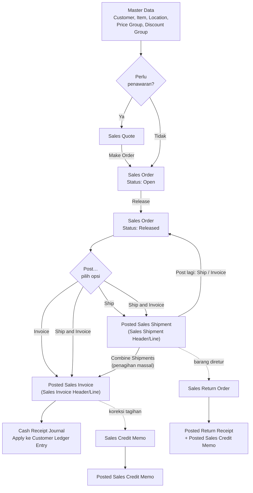
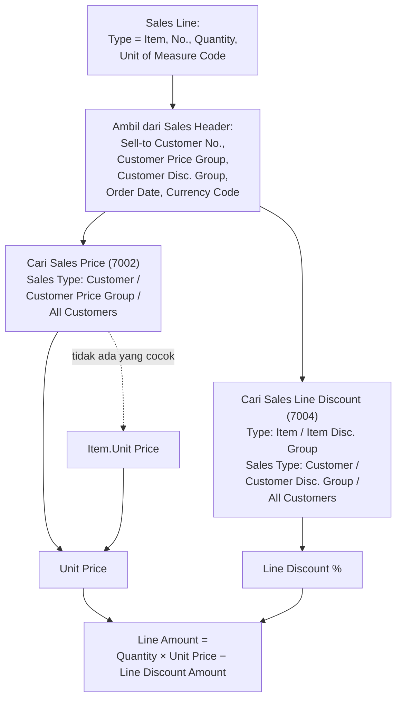
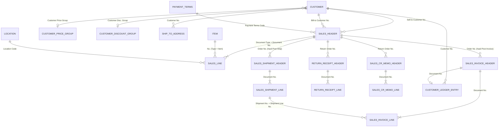

# Selling Flow (Alur Penjualan) NAV 2017

> Pasangan ERPNext: Quotation → Sales Order → Delivery Note → Sales Invoice → Payment Entry → Sales Return / Credit Note.
> Dikecualikan sesuai permintaan: entri akuntansi (G/L) dan pergerakan stok (Item Ledger / Value Entry).
> Mekanisme harga dan diskon (Customer Price Group, Customer Discount Group) dibahas lengkap di [file 04](04-customer-price-group-dan-discount-group.md).

---

## 1. Gambaran Alur

Catatan: pesanan yang **sudah dikirim seluruhnya dan sudah ditagih seluruhnya** otomatis dihapus dari daftar Sales Order (diarsipkan bila `Archive Quotes and Orders` aktif).

---

## 2. Jenis Dokumen Penjualan

Semua jenis berada di tabel yang sama (**Sales Header 36** / **Sales Line 37**) dan dibedakan oleh `Document Type`.

| Document Type | Fungsi | Hasil Posting | Padanan ERPNext |
|---------------|--------|---------------|-----------------|
| **Quote** | Penawaran ke customer | Tidak diposting; `Make Order` atau `Make Invoice` | Quotation |
| **Blanket Order** | Kesepakatan jumlah besar, dipecah per pengiriman | Tidak diposting; `Make Order` | Blanket Order |
| **Order** | Pesanan penjualan | `Ship` → Posted Sales Shipment; `Invoice` → Posted Sales Invoice | Sales Order |
| **Invoice** | Tagihan langsung tanpa Order | Posted Sales Invoice (+ Posted Shipment bila `Shipment on Invoice` aktif) | Sales Invoice (tanpa SO) |
| **Return Order** | Retur dari customer | `Receive` → Posted Return Receipt; `Invoice` → Posted Sales Credit Memo | Sales Return |
| **Credit Memo** | Nota kredit langsung | Posted Sales Credit Memo (+ Return Receipt bila `Return Receipt on Credit Memo` aktif) | Credit Note |

Menu: **Search → Sales Quotes / Sales Orders / Sales Invoices / Sales Return Orders / Sales Credit Memos**.

---

## 3. Struktur Dokumen

### 3.1 Sales Header (36)

| Field | Fungsi / Catatan |
|-------|------------------|
| `Document Type`, `No.` | Kunci. `No.` otomatis dari series sesuai `Document Type` |
| `Sell-to Customer No.` | **Customer pemesan.** Saat diisi, NAV menyalin banyak default dari Customer Card |
| `Sell-to Customer Name`, alamat | Salinan dari Customer (bisa diubah di dokumen) |
| `Bill-to Customer No.` | Customer yang ditagih (default sama dengan Sell-to, atau `Bill-to Customer No.` di Customer Card) |
| `Ship-to Code` | Alamat kirim dari tabel Ship-to Address |
| `Order Date` | Tanggal pesanan |
| `Posting Date` | Tanggal pembukuan; **harus dalam rentang posting yang diizinkan** |
| `Document Date` | Tanggal dokumen |
| `Due Date` | Jatuh tempo; dihitung dari `Payment Terms Code` |
| `Requested Delivery Date`, `Shipment Date` | Tanggal kirim yang diminta customer dan yang dijadwalkan |
| `External Document No.` | Nomor PO dari customer. **Wajib** jika `Ext. Doc. No. Mandatory` aktif |
| `Payment Terms Code`, `Payment Method Code`, `Shipment Method Code` | Default dari Customer |
| `Location Code` | Gudang pengirim (default dari Customer; diwariskan ke Line) |
| `Currency Code` | Kosong = mata uang lokal |
| `Prices Including VAT` | Apakah `Unit Price` sudah termasuk pajak |
| `Salesperson Code` | Dari Customer atau diisi manual |
| **`Customer Price Group`** | **Disalin dari Customer** saat `Sell-to Customer No.` diisi; dipakai mencari **Sales Price** |
| **`Customer Disc. Group`** | **Disalin dari Customer**; dipakai mencari **Sales Line Discount** |
| `Allow Line Disc.` | Boleh tidaknya diskon baris (dari Customer Price Group bila ada, jika tidak dari Customer) |
| `Invoice Disc. Code` | Kode diskon faktur |
| `Status` | `Open`, `Released`, `Pending Approval`, `Pending Prepayment` |
| `Shipping No. Series`, `Posting No. Series` | Series nomor Posted Shipment / Posted Invoice |
| `Ship`, `Invoice` | Dicentang otomatis saat dialog Post dipilih |
| `Customer Posting Group`, `Gen. Bus. Posting Group`, `VAT Bus. Posting Group` | Disalin dari Customer |

> **Penting:** `Customer Price Group` dan `Customer Disc. Group` pada Header adalah **salinan** pada saat customer dipilih. Mengubah kelompok di Customer Card **tidak** mengubah dokumen lama. Lihat file 04.

### 3.2 Sales Line (37)

| Field | Fungsi / Catatan |
|-------|------------------|
| `Document Type`, `Document No.`, `Line No.` | Kunci baris |
| `Type` | `Item`, `G/L Account`, `Resource`, `Fixed Asset`, `Charge (Item)`; manual ini memakai `Item` |
| `No.` | Kode Item (sesuai `Type`) |
| `Description` | Diisi dari Item (bisa diubah) |
| `Location Code` | Gudang pengirim (dari Header, bisa berbeda per baris) |
| `Quantity` | Qty pesanan |
| `Unit of Measure Code` | Satuan baris; default `Sales Unit of Measure` atau `Base Unit of Measure` Item |
| `Qty. per Unit of Measure`, `Quantity (Base)` | Konversi ke satuan dasar |
| `Unit Price` | **Harga jual per satuan** (dari Sales Price, atau `Unit Price` di Item Card) |
| `Line Discount %`, `Line Discount Amount` | Diskon baris (dari Sales Line Discount atau manual) |
| `Allow Line Disc.` | Apakah baris boleh diberi diskon |
| `Line Amount` | `Quantity × Unit Price − Line Discount Amount` |
| `Allow Invoice Disc.`, `Inv. Discount Amount` | Ikut diskon faktur atau tidak, dan nilainya |
| `VAT %`, `Amount`, `Amount Including VAT` | Dihitung dari `VAT Posting Setup` |
| `Shipment Date` | Jadwal kirim baris |
| `Qty. to Ship` | Qty yang akan dikirim pada **Post berikutnya** |
| `Quantity Shipped` | Qty yang sudah dikirim (hanya bertambah karena Post) |
| `Qty. to Invoice` | Qty yang akan ditagih pada Post berikutnya |
| `Quantity Invoiced` | Qty yang sudah ditagih |
| `Qty. Shipped Not Invoiced` | `Quantity Shipped − Quantity Invoiced` |
| `Outstanding Quantity` | `Quantity − Quantity Shipped` |
| `Customer Price Group`, `Customer Disc. Group` | Tertera juga di baris sebagai referensi |
| `Item Disc. Group` | Disalin dari Item |

---

## 4. Panduan Langkah demi Langkah

> **Contoh data:** Customer `C00010 – PT Mitra Boga` (`Customer Price Group = GROSIR`, `Customer Disc. Group = DISC-A`), Item `BRS-5KG – Beras Premium` (`Item Disc. Group = SEMBAKO`), Location `GUDANG1`.

### Langkah 1 — (Opsional) Sales Quote

1. **Search → Sales Quotes → New.**
2. Isi `Sell-to Customer No.` = `C00010`, tambahkan baris Item beserta `Quantity`.
3. Kirim ke customer lewat **Print/Send → Sales Quote**.
4. Setelah disetujui, **Home → Make Order**. NAV membuat Sales Order baru dari Quote (Quote diarsipkan/dihapus sesuai setup). Opsi **Make Invoice** membuat dokumen Sales Invoice langsung.

### Langkah 2 — Membuat Sales Order

1. **Search → Sales Orders → New.**
2. Pada **header**:
   - `Sell-to Customer No.` = `C00010`. Perhatikan field yang terisi otomatis: `Payment Terms Code`, `Location Code`, `Customer Price Group`, `Customer Disc. Group`, Posting Group.
   - `Order Date`, `Posting Date`, `Shipment Date`.
   - `External Document No.` (nomor PO customer).
3. Pada **Lines**:
   - `Type = Item`, `No. = BRS-5KG`.
   - `Quantity = 60`, `Unit of Measure Code = SAK`.
   - Periksa `Unit Price` dan `Line Discount %`. Keduanya terisi otomatis dari **Sales Price** dan **Sales Line Discount** yang cocok.
   - Periksa `Location Code`.
4. Jika `Credit Warnings` / `Stockout Warning` aktif, NAV menampilkan peringatan saat limit piutang terlewati atau stok tidak cukup. Anda bisa melanjutkan atau membatalkan.

### Langkah 3 — Hitung Diskon Faktur (opsional)

Jika customer memiliki `Invoice Disc. Code` dan Anda memakai diskon faktur: **Actions → Functions → Calculate Invoice Discount** (otomatis bila `Calc. Inv. Discount` aktif).

### Langkah 4 — Release

**Home → Release** → `Status` menjadi `Released`. Untuk mengedit lagi: **Home → Reopen**.

### Langkah 5 — Post Ship (Pengiriman Barang)

1. Pada baris, isi `Qty. to Ship` (default: seluruh sisa, kecuali `Default Qty. to Ship = Blank`).
2. **Home → Post…** (atau **F9**) → pilih **Ship** → OK.
3. Hasil: **Posted Sales Shipment** dibuat di `Sales Shipment Header` / `Sales Shipment Line`. Pada Order, `Quantity Shipped` bertambah, `Outstanding Quantity` berkurang, dan `Qty. to Invoice` terisi senilai qty yang sudah dikirim tetapi belum ditagih.
4. Cetak surat jalan: pada Posted Sales Shipment pilih **Print**.

### Langkah 6 — Post Invoice (Penagihan)

1. Pastikan `Qty. to Invoice`, `Unit Price`, dan diskon sudah benar.
2. **Post…** → pilih **Invoice** (atau **Ship and Invoice** bila kirim dan tagih bersamaan).
3. Hasil: **Posted Sales Invoice** dibuat di `Sales Invoice Header` / `Sales Invoice Line`. `Quantity Invoiced` bertambah. Jika Order sudah dikirim dan ditagih seluruhnya, Order hilang dari daftar.

> **Opsi Post pada penjualan:** `Ship` · `Invoice` · `Ship and Invoice`.

### Langkah 7 — Contoh Pengiriman Parsial

Order 60 SAK. Dikirim dua kali, lalu ditagih sekali.

| Kejadian | Qty to Ship | Quantity Shipped | Outstanding Quantity | Qty. Shipped Not Invoiced | Dokumen Terposting |
|----------|-------------|------------------|----------------------|---------------------------|--------------------|
| Order dibuat | 60 | 0 | 60 | 0 | - |
| Post Ship 40 | 40 → 20 | 40 | 20 | 40 | Posted Shipment #1 (40) |
| Post Ship 20 | 20 → 0 | 60 | 0 | 60 | Posted Shipment #2 (20) |
| Post Invoice 60 | - | 60 | 0 | 0 | Posted Invoice #1 (60), merujuk ke kedua Shipment; Order dihapus |

### Langkah 8 — Menagih Banyak Shipment Sekaligus

**Cara A: dokumen Sales Invoice + Get Shipment Lines**
1. **Search → Sales Invoices → New**, isi `Sell-to Customer No.`
2. **Lines → Functions → Get Shipment Lines**, pilih baris Posted Shipment yang ditagih → OK.
3. **Post**.

**Cara B: batch job Combine Shipments** (penagihan massal)
1. Pada Customer Card, centang `Combine Shipments`.
2. **Search → Combine Shipments**, tentukan filter customer dan periode, jalankan.
3. NAV membuat dokumen **Sales Invoice** (belum diposting) yang dapat Anda tinjau lalu Post.

### Langkah 9 — Invoice Langsung Tanpa Order

**Sales Invoices → New** → isi baris Item → **Post**.
Jika `Shipment on Invoice` aktif di Sales & Receivables Setup, NAV otomatis membuat Posted Sales Shipment.

### Langkah 10 — Pelunasan Customer (Cash Receipt)

Setelah Posted Sales Invoice terbentuk, NAV mencatat piutang di **Customer Ledger Entry (21)** (sub-ledger piutang, bukan G/L). Entri `Open` sampai dilunasi.

1. **Search → Cash Receipt Journals** → pilih *Batch*.
2. Baris baru: `Document Type = Payment`, `Account Type = Customer`, `Account No. = C00010`, `Amount` sesuai penerimaan.
3. Isi `Applies-to Doc. Type = Invoice` dan `Applies-to Doc. No. = (nomor Posted Sales Invoice)`.
4. Lengkapi akun bank (`Bal. Account`), yang ditentukan finance.
5. **Post**. Entri invoice berubah `Open = No` jika lunas.

Alternatif: **Customer Ledger Entries → Apply Entries**, atau **Reminder / Finance Charge** untuk penagihan keterlambatan (di luar cakupan).

### Langkah 11 — Retur dan Koreksi

| Situasi | Cara |
|---------|------|
| Barang diretur customer | **Sales Return Order**: salin baris dari dokumen terposting (`Get Posted Document Lines to Reverse`), lalu Post **Receive** (Return Receipt), kemudian **Invoice** (Credit Memo) |
| Salah tagih (harga/qty) | **Sales Credit Memo** lalu buat Invoice baru yang benar |
| Shipment salah dan belum ditagih | **Undo Shipment** pada Posted Sales Shipment Lines |
| Invoice salah total | Pada Posted Sales Invoice tersedia **Correct** / **Cancel** / **Create Corrective Credit Memo** sesuai kondisi |

---

## 5. Hubungan dengan Harga dan Diskon (Ringkas)

Saat `No.` atau `Quantity` pada Sales Line diisi, NAV otomatis mencari:

Aturan lengkap, contoh perhitungan, dan daftar pemeriksaan jika harga/diskon tidak muncul ada di [file 04](04-customer-price-group-dan-discount-group.md).

---

## 6. Relasi Tabel Penjualan

### 6.1 Daftar Relasi

| Dari (Tabel.Field) | Ke (Tabel.Field) | Keterangan |
|--------------------|------------------|------------|
| Sales Header.`Sell-to Customer No.` | Customer.`No.` | |
| Sales Header.`Bill-to Customer No.` | Customer.`No.` | |
| Sales Header.`Ship-to Code` | Ship-to Address.(`Customer No.`, `Code`) | |
| Sales Header.`Payment Terms Code` | Payment Terms.`Code` | |
| Sales Header.`Payment Method Code` | Payment Method.`Code` | |
| Sales Header.`Shipment Method Code` | Shipment Method.`Code` | |
| Sales Header.`Location Code` | Location.`Code` | |
| Sales Header.`Salesperson Code` | Salesperson/Purchaser.`Code` | |
| Sales Header.`Customer Price Group` | Customer Price Group.`Code` | Salinan dari Customer |
| Sales Header.`Customer Disc. Group` | Customer Discount Group.`Code` | Salinan dari Customer |
| Sales Line.(`Document Type`, `Document No.`) | Sales Header.(`Document Type`, `No.`) | Header → Lines (1:N) |
| Sales Line.`No.` | Item.`No.` (jika `Type = Item`) | Relasi bersyarat |
| Sales Line.`Unit of Measure Code` | Item Unit of Measure.(`Item No.`, `Code`) | |
| Sales Line.`Item Disc. Group` | Item Discount Group.`Code` | Salinan dari Item |
| Sales Shipment Header.`Order No.` | Sales Header.`No.` (Order) | Shipment merujuk Order asal |
| Sales Shipment Line.`Document No.` | Sales Shipment Header.`No.` | |
| Sales Invoice Header.`Order No.` | Sales Header.`No.` (Order) | |
| Sales Invoice Line.`Shipment No.` / `Shipment Line No.` | Sales Shipment Line.(`Document No.`, `Line No.`) | Invoice merujuk Shipment yang ditagih |
| Customer Ledger Entry.`Customer No.` | Customer.`No.` | Sub-ledger piutang |
| Customer Ledger Entry.`Document No.` | Sales Invoice Header.`No.` (untuk `Document Type = Invoice`) | |

### 6.2 Tabel Dokumen Kerja vs Terposting

| Dokumen kerja | Tabel | Dokumen terposting | Tabel |
|---------------|-------|--------------------|-------|
| Sales Order/Invoice Header | Sales Header (36) | Posted Sales Shipment Header | Sales Shipment Header (110) |
| Sales Order/Invoice Line | Sales Line (37) | Posted Sales Shipment Line | Sales Shipment Line (111) |
| | | Posted Sales Invoice Header | Sales Invoice Header (112) |
| | | Posted Sales Invoice Line | Sales Invoice Line (113) |
| Sales Credit Memo (header/line) | Sales Header / Line | Posted Sales Credit Memo Header | Sales Cr.Memo Header (114) |
| | | Posted Sales Credit Memo Line | Sales Cr.Memo Line (115) |
| Sales Return Order (header/line) | Sales Header / Line | Posted Return Receipt Header | Return Receipt Header (6660) |
| | | Posted Return Receipt Line | Return Receipt Line (6661) |

### 6.3 ER Diagram

---

## 7. Daftar Error Umum Saat Posting Penjualan

Teks pesan di bawah bersifat kurang lebih; versi/bahasa aplikasi bisa sedikit berbeda.

| Pesan / Gejala | Penyebab | Solusi |
|----------------|----------|--------|
| *Customer Posting Group must have a value* | Master Customer belum lengkap | Lengkapi di Customer Card |
| *Gen. Prod. Posting Group must have a value* / *Inventory Posting Group …* | Master Item belum lengkap | Lengkapi di Item Card |
| *General Posting Setup does not exist* / *VAT Posting Setup does not exist* | Kombinasi posting group belum ada di setup | Minta finance membuat record setup |
| *Posting Date is not within your range of allowed posting dates* | Tanggal di luar `Allow Posting From/To` | Ubah `Posting Date` atau minta admin memperbarui rentang |
| *External Document No. must have a value* | `Ext. Doc. No. Mandatory` aktif | Isi `External Document No.` |
| *Credit limit / overdue* muncul sebagai peringatan | `Credit Warnings` aktif | Periksa piutang customer, tindak lanjuti sesuai kebijakan |
| *Availability warning* | Stok tidak cukup dan `Stockout Warning` aktif | Cek stok atau jadwal penerimaan |
| Tidak bisa Post Invoice melebihi qty terkirim | `Qty. to Invoice` > `Quantity Shipped` | Post Ship dulu atau kurangi `Qty. to Invoice` |
| Dokumen tidak bisa diedit | `Status = Released` | **Reopen** |
| Customer tidak bisa dipilih / ditransaksikan | `Blocked = Ship / Invoice / All` | Cek status blokir di Customer Card |
| Harga/diskon tidak sesuai harapan | Lihat daftar pemeriksaan | [File 04, bagian 7](04-customer-price-group-dan-discount-group.md) |

---

## 8. Ringkasan Perbandingan dengan ERPNext

| Langkah | ERPNext | NAV 2017 |
|---------|---------|----------|
| Penawaran | Quotation | Sales Quote → **Make Order** |
| Pesanan | Sales Order → Submit | Sales Order → **Release** |
| Pengiriman | Create → Delivery Note | **Post → Ship** pada Order yang sama |
| Penagihan | Create → Sales Invoice | **Post → Invoice** pada Order yang sama |
| Parsial | Delivery Note baru per sebagian | Ubah `Qty. to Ship`, Post berulang |
| Menagih banyak pengiriman | Sales Invoice dari banyak Delivery Note | **Get Shipment Lines** atau batch **Combine Shipments** |
| Harga | Item Price (Price List) | **Sales Price** (per Customer / Customer Price Group / All Customers) |
| Diskon | Pricing Rule | **Sales Line Discount** (per Customer / Customer Disc. Group / All Customers) |
| Penerimaan pembayaran | Payment Entry | Cash Receipt Journal + `Applies-to Doc.` |
| Retur | Sales Return / Credit Note | Return Order / Credit Memo |

---

*Sebelumnya: [Selling Flow](../transaction/selling-flow.md)* · Lanjut ke: [Misc](../misc/customer-price-group-dan-discount-group.md)